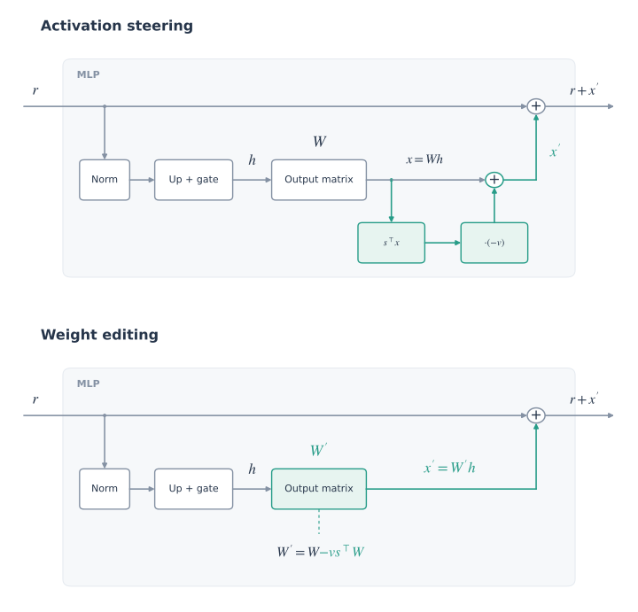
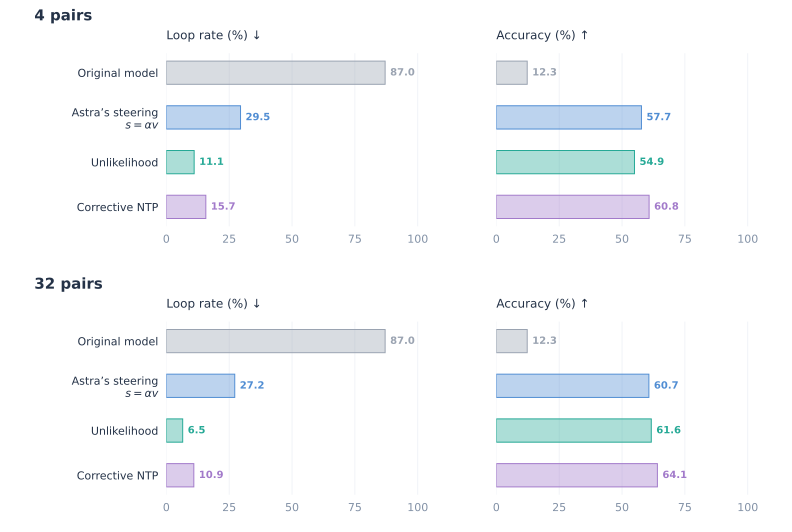

# Astra’s improvement of Qwen’s math is not “native weight editing” but context-dependent activation steering with clever use of synthetic data

In a recently widely circulated blog post [*Sparks of Weight-Space Programming*](https://rikiyat.github.io/blog/weight-space-programming/), the authors highlight how GPT-6 Astra “natively” edits another small language model without any training: it writes a short program that changes parts of the MLP weight matrices to significantly improve the math performance of the model. The authors present this as evidence for a new paradigm they call Weight-Space Programming, stating that "neural network weights will soon be natively optimized by LLMs that deliberately reason about their weights.” The work has received lots of attention. For example, one of the author’s [tweet](https://x.com/rikiyatakehi/status/2117313742891327994) has been viewed nearly 10 million times. This is indeed a remarkable algorithmic performance by Astra, however we provide an alternative interpretation on how it is achieved. While the authors and many commentators interpret this as an "native" weight edit, we show that Astra implemented an algorithm similar to activation steering methods already commonly known in the literature, using, furthermore, cleverly generated synthetic data. Viewed this way, we can also improve the method over Astra’s original edit.

## TL;DR

- **[Astra’s Qwen edit](https://rikiyat.github.io/blog/weight-space-programming/) is equivalent to activation steering:** push the activation along a fixed direction constructed from data, with a strength linearly dependent on the current activations.
- **Training the "sensing vector", which adaptively changes steering strength depending on the context, can further reduce looping.** In the same setup as the original blog, our trained sensing vectors suppress exact repetition much more than Astra’s edit, which fixes the sensing direction to be the same as the steering direction.
- **Astra generated short synthetic trace pairs to build steering direction**, we find this to steer better than directions built from actual traces generated by Qwen.
  

## 1. From a “native weight edit" to activation steering

In the authors’ words:

>All of this is possible without allowing Astra to write training loops. It uses its reasoning to figure out what each part of a neural network computes, or should compute, and changes the weights accordingly. We call this Weight-Space Programming. Throughout the history of deep learning, we encoded our simplistic inductive biases into tiny symbolic optimizers like Adam or Muon. This is changing: our neural network weights will soon be natively optimized by LLMs that deliberately reason about their weights.

For the Qwen3.5-0.8B edit, we show below that it is a special case of a known form of context-dependent activation steering, and that in some settings this view lets us improve on it.

There is already a discussion of how to understand “native weight editing” as described in the original blog post. See [Matthew Honnibal’s account of the tools and feedback](https://honnibal.dev/blog/astra-read-write-misleading), [Sean Goedecke’s commentary](https://seangoedecke.com/llms-are-not-superhuman-at-reading-and-writing-neural-network-weights/), and [crabbix’s LessWrong post](https://www.lesswrong.com/posts/uvKSq6eWkud997ie7/). We provide a formulation of this algorithm, some experiments decoupling sensing from steering, and highlighting Astra’s clever use of synthetic data.

### Formulation: activation steering

Take any block of a transformer, let the MLP’s hidden activations right before output/down-projection layer be \(h\), its output weight matrix be \(W\), the residual stream \(r\), and this MLP's contribution to the residual stream be \(x=Wh\). Steering is the process of adding a vector to \(x\), \(h\), or \(r\) to elicit certain behaviors from the model. Consider the steered activation vector

$$
x' = x-(s^\top x)v.
$$

There are two vectors here:

- \(v\), called the **steering direction**, says where to push;
- \(s\), called the **sensing vector**, the inner product \(s^Tx\) determines the steering strength given an input/context.

*The same correction applied to the MLP output (top) or folded into its output matrix (bottom).*

Here the strength depends on the output of the MLP. Because the strength is linear, this intervention is the same as a weight edit to the MLP output weight matrix assuming no bias:

$$
W'=W-vs^\top W,
\qquad W'h=Wh-v(s^\top Wh) = x'.
$$

In this framing, **Astra's edit on Qwen picks $s = \alpha v$**. In general, one is free to design both $s$ and $v$; in this post we focus on training $s$, which further reduces looping.

We call this formulation **activation steering**, not to be confused with another form of steering which does \(x’ = x - \gamma v\), where \(\gamma\) is a fixed number and context independent. The terminology is based on **Contextual Linear Activation Steering (CLAS), [Hsu et al., 2026](https://arxiv.org/html/2604.24693v2)**, which explicitly trains a sensing vector. 

**Literature Attribution**: The connection to weight edits was established in **[Arditi et al., 2024](https://arxiv.org/html/2406.11717v3)** derive weight orthogonalization and prove its equivalence to directional ablation; Other relevant work include **[Lee et al., 2025](https://arxiv.org/abs/2409.05907)**, **[Wu et al., 2024](https://arxiv.org/html/2404.03592v3)**, and **[Meng et al., 2022](https://arxiv.org/abs/2202.05262)**.

## 2. Qwen's inability for math in the original blog is pathological 

We reproduce the experiment in Qwen3.5-0.8B’s thinking mode under the blog setting, see [reproduction details](#reproduction-details) and [code](https://github.com/Zhi0467/qwen-loop-steering-experiments). Here “Astra’s steering” means $s=4v$, with $v$ built from Astra’s four synthetic pairs.

Throughout this post, a **loop** means a 30-token sequence appearing at least 20 times, a trace is said to loop if it contains at least one loop, **cap hit** means generation reaching a preset token cap.

Our evaluation uses the same problems as the original blog: 576 GSM8K training problems and 576 MATH training problems.

| Reference                     | Accuracy | Loop  | Cap hit |
| ----------------------------- | -------: | ----: | ------: |
| Unedited, thinking on         | 12.3%    | 87.0% | 88.5%   |
| Unedited, thinking off        | 53.3%    | 4.5%  | 5.3%    |
| Astra’s steering                  | 57.7%    | 29.5% | 23.7%   |

 We note the steering as mainly fixing a pathological generation behavior, rather than eliciting new mathematical capability. 

## 3. Training the sensing vector can improve on Astra’s steering

The canonical steering method from the original blog sets \(s=\alpha v\). It uses the same direction to recognize the sense the context and to push/steer it. We keep \(v\) fixed and train \(s\), initialized at \(s = 0\) rather than \(v\), on a dataset that can consist of traces with and without loops. To clarify terminology, non-loop = productive (as in their blog) = positive, and conversely, loop = negative. We compare three loss functions for training \(s\).

Let \(p_s\) be the steered model and \(p_0\) the original model. Define next token prediction loss, unlikelihood loss, and KL divergence:

$$
\begin{aligned}
L_{\mathrm{NTP}}(s)&=-\mathbb{E}_{+}\log p_s(y_t\mid y_{<t}),\\
L_{\mathrm{UL}}(s)&=-\mathbb{E}_{-}\log\bigl(1-p_s(y_t\mid y_{<t})\bigr),\\
L_{KL}(s)&=\mathbb{E}_{+}D_{\mathrm{KL}}\!\left(p_0(\cdot\mid y_{<t})\,\|\,p_s(\cdot\mid y_{<t})\right).
\end{aligned}
$$

Here \(\mathbb{E}_{+}\) averages over positive tokens in the dataset; \(\mathbb{E}_{-}\) averages over repetitive tokens from the second copy of the repeated chunk onward. We average tokens within each trace, then average across pairs. Only \(s\) is optimized, model weights are frozen. The KL regularization coefficient is \(\beta\in\{0,0.1\}\). 

| Label we use         | Training signal on s                                                      | Objective to minimize                      |
| -------------------- | ------------------------------------------------------------------------- | ------------------------------------------ |
| **clas**             | Increase next-token likelihood on positive traces                         | $L_{\mathrm{NTP}}+\beta L_{KL}$                 |
| **ul**               | Decrease the probability of repeated tokens in negative traces            | $L_{\mathrm{UL}}+\beta L_{KL}$                  |
| **contrast**         | Combine positive next-token likelihood with repetitive-token unlikelihood | $L_{\mathrm{NTP}}+L_{\mathrm{UL}}+\beta L_{KL}$ |
| **\(s = \alpha v\)** | \(\alpha\) is sweeped                                                     | -                                          |

We use either the four original pairs (copied from the original blog’s repo) or those four plus 28 additional hand-written pairs. The same dataset is used to construct \(v\) and train \(s\).

For example, one of Astra’s four pairs shares this prompt and opening:

> **Prompt:** A machine makes 45 necklaces, and another makes 2.4 times as many. Find the total.
>
> **Shared opening:** The second machine makes 45*2.4=108 necklaces. Add the first machine's 45 to obtain 153 necklaces.

The two continuations are:

> **Positive:** Multiplication gives the second quantity, while addition combines the two machines. A check is 45*3.4=153.
>
> **Loop:** Is 108 the total? No, 45+108=153. Is 108 the total? No, 45+108=153. Is 108 the total? No, 45+108=153.

At each steered layer, \(v\) is the difference between the mean residual stream over the last 36 tokens of the repetitive text and that of the productive text, averaged over pairs and normalized to unit length. For \(s = \alpha v\) (Astra's method) we sweep \(\alpha\). Sensing vector training uses Adam with early stopping. Development data select hyper-parameters and early stop step.

**The goal is to reduce the fraction of traces that loop, while accuracy, thinking closure, and cap hits are tracked as side effects.** 

### Result: less looping with trained sensing vector

  

*Figure 1a. Qwen3.5-0.8B on GSM8K, 576 test problems. Cells show percentage-point differences: left, versus unedited thinking-on; right, versus \(s=\alpha v\) at the same pair count \(N\). Green indicates improvement; red, deterioration. Stars mark 95% paired bootstrap intervals excluding zero. Colors saturate at ±50 points (left) and ±10 (right).*

  

*Figure 1b. Qwen3.5-0.8B on MATH, 576 test problems. Comparisons, colors and stars follow Figure 1a.*

Figures 1a and 1b show each dataset separately. Figure 1c pools GSM8K and MATH, 1,152 test problems in total.

*Figure 1c. Pooled GSM8K and MATH results, including the original thinking-on model (gray). Lower loop fraction is better; higher accuracy is better. Bars show the observed percentages. Astra’s steering uses four pairs and \(s=4v\); the 32-pair \(s=\alpha v\) arm also uses \(s=4v\).*

With 32 pairs, training $s$ reduces the loop fraction from **27.2%** to **6.5–6.8%**. At 4 pairs, it falls from **29.5%** to roughly **11%**. Training $s$ can do the intended job of fixing this pathological behavior better. Positive-only training (clas) is markedly worse: negative examples matter.

## 4. Where do steering vectors come from and where to sense?

### Short synthetic pairs are especially effective for steering direction
We compare two ways of constructing the steering vector, one by taking averaged difference of residuals on the synthetic pairs, the other on much longer natural rollout pairs. Setup: **Qwen3-1.7B, greedy decoding, MLP-output steering at blocks 15–18**, with the test prompts and the selection and stopping rules of Section 5. We compare directions from model-generated loop/non-loop responses against the 32 short synthetic pairs used in Section 5. The natural traces are the unedited model's own responses, 32 looping and 32 non-looping across both benchmarks, and \(v\) is built from the mean of differences of 36-token windows, just like the short synthetic case. We test both \(s=\alpha v\) and a trained unlikelihood \(s\) ([details](#reproduction-details)).

*Qwen3-1.7B, 500 prompts per dataset. Changes from the original model with 95% intervals. Slate circles: short synthetic pairs; rose diamonds: natural traces.*

Overall, short synthetic pairs give much stronger loop reduction without compromising accuracy. Our tentative explanation: long responses differ in content, position and reasoning path as well as looping, adding unrelated variation to the activation contrast. Short synthetic pairs may isolate repetition more cleanly.

### Where to sense: MLP output or residual stream?

There are three sites worth distinguishing: MLP hidden activations before output \(h\), the MLP output \(x=Wh\), and the residual stream \(r\).Even when two interventions use the same \(v\) and \(s\),

$$
x'=x-v(s^\top x)
\qquad\text{and}\qquad
r'=r-v(s^\top r)
$$

sense different quantities. The second sensing sees the accumulated stream: the embedding, every earlier attention and MLP output, and the corrections made by earlier steering interventions.

This changes what the same \(s\) does. Take \(s=\alpha v\) with unit \(v\). At the output, each steering intervention multiplies the sensed coordinate of its own MLP's output by \(1-\alpha\), once, and leaves the rest of the stream alone. On the residual stream, each steered layer acts on everything already in the stream, so content from before the first steered layer is multiplied by \(1-\alpha\) at every steered layer: by \((1-\alpha)^2\) over two layers. At \(\alpha=1\) this is directional ablation of \(v\) ([Arditi et al., 2024](https://arxiv.org/html/2406.11717v3)). For \(1<\alpha<2\) the coordinate flips sign and shrinks, and for \(\alpha>2\) it flips sign and grows. 

We moved these two $N = 32$ steering methods from the MLP output to the residual stream in the Astra setup, keeping \(v\) and \(s\) unchanged. We also recalibrated $\alpha$ for the residual stream with \(\alpha\in\{0.2,0.5,1,1.5\}\), chosen on the development problems like every other setting. Development accuracy was 39.8%, 66.0%, 66.0% and 63.7%; of the two tied settings, \(\alpha=1\) loops less (3.5% against 12.5%) and was chosen. On the 1,152 test problems:

*Pooled GSM8K and MATH results, 1,152 test problems. Blue: \(s=\alpha v\); green: unlikelihood-trained \(s\). Residual \(s=v\) uses the recalibrated strength. Bars show observed percentages.*

The sensing vector trained on the MLP output transfers to the residual stream with a similar benefit. The \(s=\alpha v\) arm needs \(\alpha\) retuned. Recalibrated to \(\alpha=1\), it gives a similar benefit to the MLP-output steering methods: about the same accuracy, with loop rates as low as the trained sensing vector's.

## 5. A non-pathological setting shows loop reduction with similar accuracy

We also test Qwen3-1.7B under greedy decoding, steering at blocks 15–18, on 500 MATH level-5 and 500 LiveCodeBench prompts ([reproduction details](#reproduction-details)). Unlike the Astra setting, thinking here is worth a great deal: turning it off costs 26.4 accuracy points. Here are some observations:
- either \(s = \alpha v\) or a trained sensing vector can reduce loop more than thinking off (except for N = 32 clas).
- sensing vectors trained on negative examples reduce more loops than \(s = \alpha v\).
- sensing vectors trained on negative examples can minimally hurt accuracy on non-loop examples.
- overall, this modestly shows activation steering as a way to reduce loop while retaining accuracy in a **non-pathological setting.**

The pairs for training $s$ and building $v$ are math-style text, yet the steering also helps suppress loops on code, loop suppression seems to transfer with these directions. Our development-selected settings have not found a trained sensing vector accuracy advantage here, but it still tends to reduce looping more than \(s = \alpha v\) which is the intended effect. 

*Figure 2a. Qwen3-1.7B on 500 MATH level-5 prompts, greedy decoding. Cells show percentage-point differences versus unedited thinking-on (left) and \(s=\alpha v\) at the same pair count (right). Green indicates improvement; red, deterioration. Stars mark 95% paired bootstrap intervals excluding zero. Accuracy colors saturate at ±8 points.*

*Figure 2b. Qwen3-1.7B on 500 LiveCodeBench prompts, greedy decoding. Comparisons, colors and stars follow Figure 2a. Both benchmarks use math-style steering pairs.*

## 6. Notes 

**Reproduction details.** Code can be found [here](https://github.com/Zhi0467/qwen-loop-steering-experiments).

| Item                      | Astra-regime comparison                                           | Qwen3 comparison                                                            |
| ------------------------- | ----------------------------------------------------------------- | --------------------------------------------------------------------------- |
| Model                     | Qwen3.5-0.8B, revision `2fc06364715b967f1860aea9cf38778875588b17` | Qwen3-1.7B, revision `70d244cc86ccca08cf5af4e1e306ecf908b1ad5e`             |
| Steered layers, zero-based | 15, 19                                                            | 15–18                                                                       |
| Development prompts       | 128, `validation_1`                                               | 256, balanced by dataset and saved loop label                               |
| Evaluation prompts        | 1,152: `validation_3/4`, `final_1–3`                              | 1,000: 500 per dataset, 391 previously looping                              |
| Decoding                  | T=0.6, top-p=0.95, top-k=20, presence=1.5                         | Greedy                                                                      |
| Limit                     | 32,768 new tokens                                                 | 40,960-token total context                                                  |
| Runtime                   | vLLM 0.22.1; transformers 5.22.1; H100                            | Same stack; H100s on two machines                                           |
| Grading                   | Boxed-answer extraction and math-verify 0.9.0                     | MATH answer verification; LiveCodeBench native tests                        |
| Uncertainty               | Paired problem bootstrap                                          | Paired prompt bootstrap, stratified by source, dataset and saved loop label |

**Qwen3 test sampling.** From all MATH level-5 splits and LiveCodeBench v1–v6, excluding 256 development prompts, we retained every prompt that looped in any of four earlier greedy Qwen3-1.7B draws (174 MATH, 217 LiveCodeBench) and filled each dataset to 500 by seeded uniform sampling of the rest. Pooled metrics are plain means over these 1,000 prompts.

**Natural traces (§4).** The looping examples are the last 36 loop tokens of 32 looping traces from the unedited model's greedy development rollouts (9 MATH, 23 LiveCodeBench; few MATH development traces loop). The non-looping examples are the last 36 thinking tokens before `</think>` of 32 traces that finish (16 per dataset). Prompts whose traces the stopping rule scores are excluded. As with the short pairs, \(v\) is the per-layer difference of mean activations, and the trained \(s\) uses unlikelihood on the loop tokens plus \(\beta\) times the KL divergence on the non-looping tokens. The 64 prompts behind these traces are removed from development, so both data sources are selected on the remaining 192 development prompts, over \(\alpha \in \{1,2,3,4\}\) and \(\beta \in \{0, 0.1\}\). Short pairs choose \(s = 2v\), natural traces \(s = v\), and both choose \(\beta = 0\). The natural \(v\) has cosine 0.54–0.59 with the short-pair \(v\).

**Using short synthetic pairs is a clever choice.** Astra’s short contrast pairs and simple \(s = \alpha v\) are productive choices. **Which dataset (synthetic versus long on-policy rollouts) to construct v and s, where to sense (output versus residual), and what behavior the training objective preserves** are all consequential design choices. This also suggests a constructive role for agents. An agent can search this design space, such as trying out different sensing vector training loss, test where to sense, inspect failures, and pick different train/dev sets. 

**Steering does not transfer across temperatures.** On 128 development problems, switching to greedy decoding without retuning sharply reduced accuracy: the 32-pair $s=4v$ steering fell from 63.7% to 28.1%, and trained sensing vectors also lost most of their gains. Removing only the presence penalty had a smaller effect. $s$ and $v$ that work under one temperature may need retuning under another.

**Another axis: how to construct steering direction.** We focused on $s$ in this post, but $v$ is another vector to construct from data. A natural next comparison is constructing $v$ with different algorithms: mean differences of residual, logistic regression, recursive feature machines and PCA, keeping sensing vector fixed.

**Training the sensing vector has dataset-specific side effects.** Pooled across datasets, the N=32 trained arms hit the cap more often than \(s=\alpha v\): **22.3–23.0% versus 18.3%**. They also close thinking less often. But the pooled average hides where this happens:

| N=32 change versus \(s=\alpha v\) | GSM8K: UL / contrast | MATH: UL / contrast |
| ------------------------------------------- | -------------------: | ------------------: |
| Accuracy                                    | +1.8 / +3.2 pp       | +0.1 / −1.6 pp      |
| Exact-loop flag                             | −11.5 / −11.3 pp     | −29.9 / −29.5 pp    |
| Cap hits                                    | −0.6 / −1.0 pp       | +8.6 / +10.4 pp     |
| Thinking closure                            | +2.1 / +1.6 pp       | −16.9 / −17.2 pp    |

On GSM8K, the completion metrics move in the favorable direction numerically. On MATH, exact repetition falls dramatically, but more answers exhaust the budget and fewer close thinking. Of the capped unlikelihood responses, 78% do not loop. Suppressing exact repetition has led to the steered model paraphrasing while hitting generation cap in some cases. Can we steer multiple behaviors at once? 

**Neuron selection in Astra’s final steering.** Later in the same run, Astra restricted steering to 64 MLP neurons per layer. This version reaches 60.2% accuracy, 29.6% looping and 18.2% cap hits; our main baseline uses the earlier $s=4v$ steering (57.7%, 29.5% and 23.7%).

With diagonal neuron mask \(M\) and unit direction \(u\), its idealized update is

$$
W'=W-6uu^\top WM,
\qquad
x'=x-u(q^\top h),\quad q=6MW^\top u.
$$

Thus \(q\) senses selected hidden neurons, rather than their combined MLP output. Selecting neurons is not the same as masking output coordinates.

Its matched random-direction control reaches 6.8% accuracy and 93.4% looping, separate from the main figures’ $s=\alpha v$ control.

**When to early stop sensing vector training?** Training uses four or 32 short synthetic productive/repetitive pairs, with the next-token, unlikelihood or combined objective above. Adam starts from \(s=0\) and takes up to 24 updates. As in ordinary ML training, we need a validation criterion to choose when to stop, but what should it measure? We can cheaply score fixed traces of a selected development set by **teacher forcing** (feeding the saved tokens), or generate fresh rollouts on development prompts and measure accuracy, repetition and completion directly at each optimization step. The former is a proxy; the latter tests the behavior we actually want despite a much more expensive validation.

We first used teacher-forced loss on six separate synthetic pairs supplied by Astra as the dev set. This selected update 24. On Qwen3-1.7B, however, the unlikelihood- and contrast-trained steering at that update frequently stopped emitting `</think>`. This suggests the dev set was not well chosen. We then picked the development set to be the unedited model’s saved traces. That did not solve the problem: unlikelihood and contrast still favored the last update, while productive-text next-token loss favored update zero, since no steering gives lowest NTP on base-model-generated traces.

Actual rollouts exposed the mismatch between proxy loss and behavior. We then used a stopping rule requiring preservation of thinking closure:

> Choose the update with the lowest unlikelihood loss on repeated tokens in the saved development traces. Require that `</think>` remains the most likely next token at least as often as the unedited model, at the positions where the unedited model originally ended its thinking.

On Qwen3 it selects earlier updates: 12–14 for the selected unlikelihood arms and 10–12 for contrast. They are what we used for the results in the next section. 

