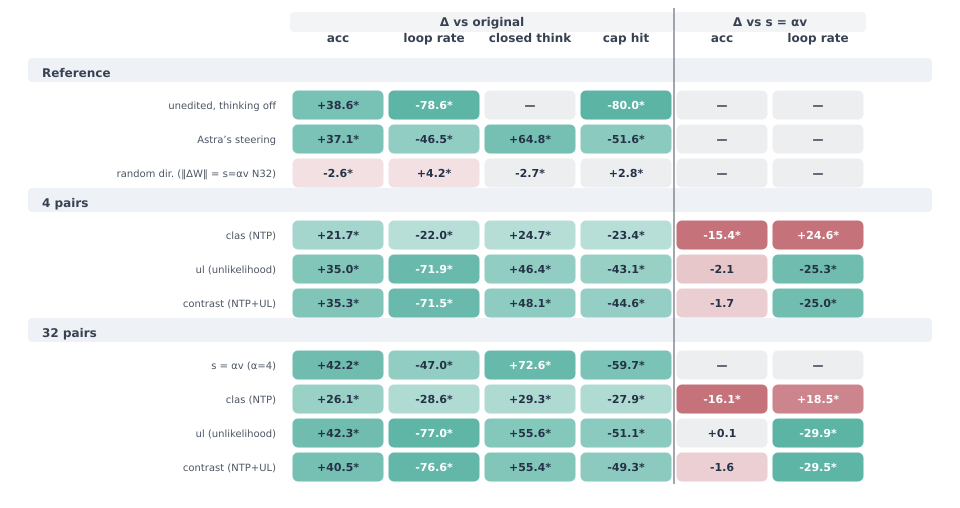
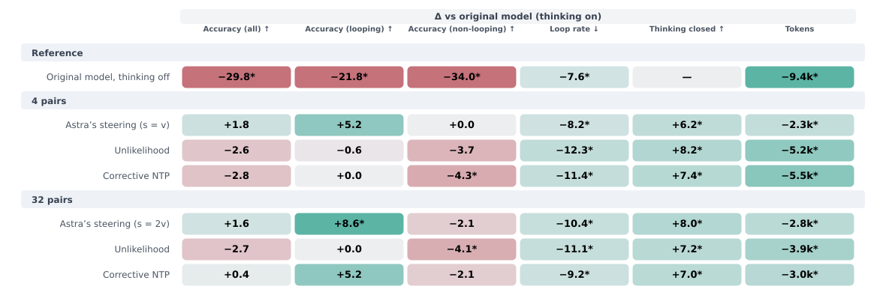
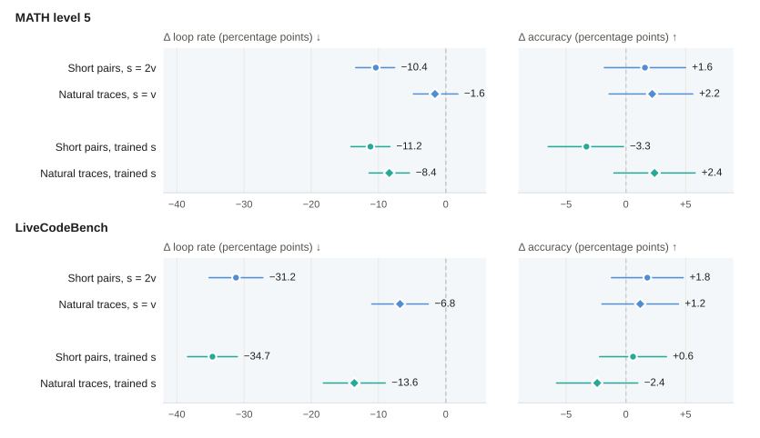
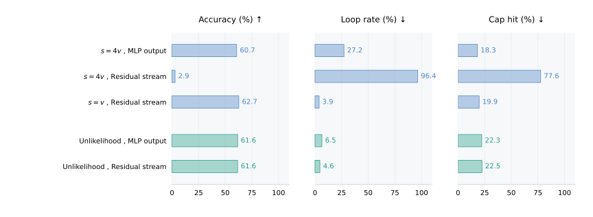

# A closer look at *Sparks of Weight-Space Programming*

GPT-6 Astra’s improvement of Qwen’s math is not “native weight editing” but activation steering with clever use of synthetic data

<a class="name" href="https://zhi0467.github.io">Zhi Wang</a>
Brandon Hsu
<a class="name" href="https://tiiao.github.io">Tianhao Wang</a>
<a class="name" href="https://misha.belkin-wang.org">Mikhail Belkin</a>

UC San Diego

In a widely circulated blog post [*Sparks of Weight-Space Programming*](https://rikiyat.github.io/blog/weight-space-programming/), the authors highlight how GPT-6 Astra edits a small language model without any training: it writes a short program that changes parts of the MLP weight matrices to significantly improve the math performance of the model. The authors present this as evidence for a new paradigm they call Weight-Space Programming, stating that “neural network weights will soon be natively optimized by LLMs that deliberately reason about their weights.” They even frame this as a shift away from symbolic optimizers like [Adam](https://arxiv.org/pdf/1412.6980), which has been the default optimizer for training deep learning models since its introduction in 2014. The post, and especially its claim that frontier LLMs like Astra can “natively” edit weights, has received considerable attention. A single [tweet](https://x.com/rikiyatakehi/status/2117313742891327994) by the lead author has been viewed nearly 10 million times (as of November 2026). While the authors and many commentators interpret Astra’s edit as “native weight editing,” we argue that Astra is acting like a clever researcher, effectively implementing existing activation steering techniques combined with synthetic data. Additionally, recognizing the edit as activation steering allows us to further improve on Astra’s approach.

## TL;DR

- [Astra’s edit of Qwen](https://rikiyat.github.io/blog/weight-space-programming/) is equivalent to a special case of context-dependent activation steering: it pushes the activations along a fixed direction constructed from data, with a strength that depends linearly on the current activations.
- Generalizing Astra’s edit, with a trained “sensing vector” that determines how strongly to push along the same fixed direction, can further improve the effectiveness of the edit.
- Astra constructs the fixed direction from short synthetic traces rather than from Qwen’s real rollouts, a design choice that turns out to be substantially more effective.

## 1. From “native weight editing” to activation steering

**Background: Astra’s approach to improving Qwen3.5-0.8B at math.**
Astra is prompted to improve the math performance of Qwen3.5-0.8B. The prompt explicitly mentions looping as a possible issue but does not say how to fix it. After some exploration, Astra settles on an approach. Here is a summary of the key steps. Astra first inspects Qwen’s rollouts and confirms that looping is a critical issue. It then generates a dataset of short synthetic pairs, with and without repetition, and uses it to build a direction \(v\) that isolates looping. It identifies key locations in the model to steer and applies \(W'=W-\alpha vv^\top W\) to the MLP output weight matrices at those locations. 

At a high level, this procedure follows a standard recipe from the activation steering literature. In particular, we show that Astra’s edit of Qwen3.5-0.8B is a special case of a known form of context-dependent activation steering, and that in some settings this view lets us improve on it.

There is already a discussion of how to understand “native weight editing” as described in the original blog post, including critical takes on its interpretation. See, for example, [Matthew Honnibal’s post](https://honnibal.dev/blog/astra-read-write-misleading), [Sean Goedecke’s commentary](https://seangoedecke.com/llms-are-not-superhuman-at-reading-and-writing-neural-network-weights/), and [crabbix’s LessWrong post](https://www.lesswrong.com/posts/uvKSq6eWkud997ie7/). Here we provide a formulation of the algorithm, experiments decoupling sensing (how much to push) from the steering direction (which way to push), and an examination of Astra’s use of synthetic data.

> **Side note — neuron selection.** Our baseline uses Astra’s \(s=4v\) steering method. Note that a later variant by Astra selects 64 neurons per layer for steering; see [the discussion below](#neuron-selection).

### Formulation: activation steering

Qwen, like most LLMs, is built from a stack of transformer blocks. Take any one of these blocks, and let the MLP’s hidden activations right before the output matrix be \(h\), its output weight matrix be \(W\), the residual stream be \(r\), and this MLP’s contribution to the residual stream be \(x=Wh\). Steering is the process of adding a vector to \(x\), \(h\), or \(r\) to elicit certain behaviors from the model. Consider the steered activation vector

$$
x' = x-(s^\top x)v.
$$

There are two vectors here:

- The **steering direction** \(v\) says where to push.
- The **sensing vector** \(s\) determines the steering strength through the inner product \(s^\top x\), where the activation \(x\) provides the context.

Here the strength depends on the output of the MLP. Because the strength is linear, this intervention is the same as a weight edit to the MLP output weight matrix (assuming no bias):

$$
W'=W-vs^\top W,
\qquad W'h=Wh-v(s^\top Wh) = x'.
$$

In this framing, **Astra's edit on Qwen picks $s = \alpha v$**. In general, one is free to design both $s$ and $v$; in this post we focus on training $s$, which further reduces looping.

*Figure 1. The two dashed paths compute the same output: weight editing gives \(x^{\prime}=W^{\prime}h\) (purple), while activation steering gives \(x^{\prime}=x-(s^\top x)v\) (green).*

We call this formulation **context-dependent activation steering**, not to be confused with another form of steering which does \(x' = x - \gamma v\), where \(\gamma\) is a fixed number and context independent. The terminology is based on **Contextual Linear Activation Steering (CLAS), [Hsu et al., 2026](https://arxiv.org/pdf/2604.24693)**, which trains a sensing vector. 

> **Side note — literature attribution.** The connection between activation and weight edits was established in **[Arditi et al., 2024](https://arxiv.org/pdf/2406.11717)** (weight orthogonalization being equivalent to directional ablation under certain conditions). Other relevant work includes **[Meng et al., 2022](https://arxiv.org/pdf/2202.05262)**, **[Zou et al., 2023](https://arxiv.org/pdf/2310.01405)**, and **[Wu et al., 2024](https://arxiv.org/pdf/2404.03592)**.

## 2. Qwen’s poor math performance in the original setup is pathological

The headline claim is that Astra edits Qwen3.5-0.8B to make it better at math. What the edit actually does is suppress looping when thinking mode is turned on, which in turn raises Qwen’s math scores. Admittedly, the original blog post mentions this but underemphasizes it.

We reproduce the experiment in Qwen3.5-0.8B’s thinking mode under the blog setting. Here “Astra’s steering” means $s=4v$, with $v$ built from Astra’s four synthetic pairs.

> **Side note — setup.** For the specific setup, see [reproduction details](#reproduction-details).

Throughout this post, a **loop** means a 30-token sequence appearing at least 20 times. A trace is said to loop if it contains at least one loop. **Loop rate** is the fraction of traces that loop. **Cap hit** means reaching the token limit.

> **Side note — token limits.** The Qwen3.5-0.8B limit counts generated tokens only; the Qwen3-1.7B limit includes the prompt. Exact budgets are in the [supplementary methods](supplementary-methods.md#detailed-protocols-and-diagnostics).

Our evaluation uses the same problems as the original blog: 576 GSM8K training problems and 576 MATH training problems.

| Reference                | Thinking | Accuracy | Loop rate | Cap hit |
| ------------------------ | :------: | -------: | --------: | ------: |
| Unedited (no steering)   | On       | 12.3%    | 87.0%     | 88.5%   |
| Unedited (no steering)   | Off      | 53.3%    | 4.5%      | 5.3%    |
| Astra’s steering         | On       | 57.7%    | 29.5%     | 23.7%   |

## 3. Training the sensing vector can improve on Astra’s steering

**Here, the goal of steering is to reduce the loop rate.** Accuracy, thinking closure, and cap hits are tracked as secondary metrics and are not directly optimized. We show that training sensing vectors can further reduce looping compared to Astra’s steering approach.

Astra’s steering approach in the original blog sets \(s=\alpha v\). It uses the same direction both to sense the context and to steer. To improve on this approach, we keep the direction to steer \(v\) the same but use \(s\) rather than \(v\) to sense. We compare Corrective next-token prediction (Corrective NTP) and Unlikelihood (UL) for training \(s\).

Specifically, let \(p_s\) be the steered model and \(p_0\) the original model. Also let **positive** (\(+\)) denote non-loop text (called “productive” in the original blog) and **negative** (\(-\)) denote loop text. We define the corrective next-token prediction loss, the unlikelihood loss, and the KL divergence as follows:

$$
\begin{aligned}
L_{\mathrm{NTP}}^{\mathrm{corr}}(s)&=-\mathbb{E}_{\mathrm{corr}}\log p_s(y_t\mid y_{<t}),\\
L_{\mathrm{UL}}(s)&=-\mathbb{E}_{-}\log\bigl(1-p_s(y_t\mid y_{<t})\bigr),\\
L_{\mathrm{KL}}(s)&=\mathbb{E}_{+}D_{\mathrm{KL}}\!\left(p_0(\cdot\mid y_{<t})\,\|\,p_s(\cdot\mid y_{<t})\right).
\end{aligned}
$$

Here \(\mathbb{E}_{\mathrm{corr}}\) averages over positive continuation tokens following loop prefixes; \(\mathbb{E}_{+}\) averages over the original positive tokens for KL; \(\mathbb{E}_{-}\) averages over loop tokens from the second copy of the repeated chunk onward. We average tokens within each trace, then average across pairs. Only \(s\) is optimized, model weights are frozen.

Based on these, we consider the following methods:

| Method             | Training data and signal for \(s\)                                | Objective                                                  |
| ------------------ | ----------------------------------------------------------------- | ---------------------------------------------------------- |
| **Corrective NTP** | Increase likelihood of positive continuations after loop prefixes | \(L_{\mathrm{NTP}}^{\mathrm{corr}}+\beta L_{\mathrm{KL}}\) |
| **Unlikelihood**   | Decrease likelihood of repeated tokens in negative traces         | \(L_{\mathrm{UL}}+\beta L_{\mathrm{KL}}\)                  |
| **\(s=\alpha v\)** | No sensing vector training; choose \(\alpha\) on development data | —                                                          |

We use either Astra’s four original pairs or those four plus 28 additional hand-written pairs. Each pair consists of two rollouts, one is positive, the other negative (containing loops). These underlying pairs are used to construct \(v\) and used to supply the training text to learn \(s\). Unlikelihood uses the negative traces. Corrective NTP places the positive continuation after varying amounts of repetition from its paired negative text.

For example, one of Astra’s four pairs shares this prompt and opening:

> **Prompt:** A machine makes 45 necklaces, and another makes 2.4 times as many. Find the total.
>
> **Shared opening:** The second machine makes 45*2.4=108 necklaces. Add the first machine's 45 to obtain 153 necklaces.

The two continuations are:

> **Positive:** Multiplication gives the second quantity, while addition combines the two machines. A check is 45*3.4=153.
>
> **Loop:** Is 108 the total? No, 45+108=153. Is 108 the total? No, 45+108=153. Is 108 the total? No, 45+108=153.

For Corrective NTP, we put copies of the loop chunk before the positive continuation and apply the next-token loss only to the positive tokens. After the same shared opening, one example is:

> Is 108 the total? No, 45+108=153. Is 108 the total? No, 45+108=153. Multiplication gives the second quantity, while addition combines the two machines. A check is 45*3.4=153.

> **Side note — corrective data.** The [construction details](supplementary-methods.md#corrective-ntp) describe how we vary the number of copies for each pair.

At each steered layer, \(v\) is the difference between the mean residual stream over the last 36 tokens of the negative text and that of the positive text, averaged over pairs and normalized to unit length. For \(s = \alpha v\) (Astra's method) we sweep \(\alpha\). Sensing vector training uses Adam with early stopping. Development data select hyper-parameters and early stop step.

### Result: less looping with trained sensing vector

  

*Figure 2a. Qwen3.5-0.8B on 576 GSM8K problems. Differences versus the original model (left) and Astra’s steering (\(\alpha=4\), matched pair count; right), in percentage points or tokens (k = thousands). Green: improvement; red: deterioration. All cells use paired bootstrap estimates; stars mark 95% intervals that exclude zero.*

  

*Figure 2b. Qwen3.5-0.8B on MATH, 576 test problems. Comparisons, colors and stars follow Figure 2a.*

Figures 2a and 2b show each dataset separately. Figure 2c pools GSM8K and MATH, 1,152 test problems in total.

*Figure 2c. Pooled GSM8K and MATH results, including the original thinking-on model (gray). Lower loop rate is better; higher accuracy is better. Bars show the observed percentages. Astra’s steering (\(s=\alpha v\)) uses \(\alpha=4\) at both pair counts.*

With 32 pairs, Unlikelihood training reduces the loop rate from **27.2%** with \(s=\alpha v\) to **6.5%**; Corrective NTP reduces it to **10.9%**. At four pairs, the corresponding loop rates are **29.5%**, **11.1%** and **15.7%**. Training \(s\) can do the intended job of fixing this pathological behavior better.

## 4. A non-pathological setting shows loop reduction with similar accuracy

We show that **steering can reduce looping in a non-pathological setting, though with smaller side effects on accuracy**.

We also test Qwen3-1.7B under greedy decoding, steering at blocks 15–18, on 500 MATH level-5 and 500 LiveCodeBench prompts. Unlike the Astra setting, thinking here is worth a great deal: turning it off costs 26.4 accuracy points. Here are some observations:

> **Side note — setup.** For the specific setup, see [reproduction details](#reproduction-details).
- either \(s = \alpha v\) or a trained sensing vector can reduce looping more than thinking off.
- Training the sensing vector can further reduce loop rates and generated token counts on average compared with \(s = \alpha v\).

The pairs for training $s$ and building $v$ are math-style text, yet the steering also helps suppress loops on code, loop suppression seems to transfer with these directions. 

*Figure 3a. Qwen3-1.7B on 500 MATH level-5 prompts, greedy decoding. Cells show differences versus the original model with thinking on, in percentage points or completion tokens (k = thousands). Green indicates improvement; red, deterioration. All cells use paired bootstrap estimates; stars mark 95% intervals that exclude zero. Accuracy colors saturate at ±8 points.*

*Figure 3b. Qwen3-1.7B on 500 LiveCodeBench prompts, greedy decoding. Comparisons, colors and stars follow Figure 3a. Both benchmarks use math-style steering pairs.*

## 5. Where do steering vectors come from and where to sense?

### Astra's short synthetic pairs are especially effective for steering direction
We compare steering directions constructed from short synthetic pairs with those constructed from the unedited model’s own looping and non-looping responses, using the Qwen3-1.7B setting of Section 4. For the natural traces, we retain the preceding response as context but use short windows of looping or non-looping text to construct \(v\) and train \(s\). We test both \(s=\alpha v\) and an Unlikelihood-trained \(s\).

> **Side note — setup.** See the supplementary methods for [trace construction](supplementary-methods.md#natural-traces) and [selection and stopping rules](supplementary-methods.md#reproduction-details).

*Figure 4. Qwen3-1.7B, 500 prompts per dataset. Changes from the original model with 95% intervals. Circles: short synthetic pairs; diamonds: natural traces. Blue: Astra’s steering; green: Unlikelihood-trained \(s\). Lower loop rate is better; higher accuracy is better. The dashed vertical line at zero marks no change from the original model.*

Overall, short synthetic pairs give much stronger loop reduction while accuracy stays roughly the same, supporting Astra’s choice of synthetic pairs for constructing the steering direction. Our tentative explanation: long responses differ in content, position and reasoning path as well as looping, adding unrelated variation to the activation contrast. Short synthetic pairs may isolate repetition more cleanly.

### Where to sense: MLP output or residual stream?

We find that **a trained sensing vector transfers directly to residual-stream sensing, whereas Astra’s \(s = \alpha v\) method needs its strength recalibrated**.

There are three sites worth distinguishing: MLP hidden activations before output \(h\), the MLP output \(x=Wh\), and the residual stream \(r\). Even when two interventions use the same \(v\) and \(s\),

$$
x'=x-v(s^\top x)
\qquad\text{and}\qquad
r'=r-v(s^\top r)
$$

sense different quantities. The second sensing sees the accumulated stream: the embedding, every earlier attention and MLP output, and the corrections made by earlier steering interventions.

> **Side note — sensing location.** This changes what the same \(s\) does. Take \(s=\alpha v\) with unit \(v\). At the output, each steering intervention multiplies the sensed coordinate of its own MLP's output by \(1-\alpha\), once, and leaves the rest of the stream alone. On the residual stream, each intervention acts on the accumulated stream. For an existing residual contribution, the direct effect of two steering interventions is \((I-\alpha v_2v_2^\top)(I-\alpha v_1v_1^\top)\). If both use the same unit direction \(v\), its coordinate along \(v\) is multiplied by \((1-\alpha)^2\). With different layer-specific directions, the product of projections replaces this scalar factor. At \(\alpha=1\) this is directional ablation of \(v\) ([Arditi et al., 2024](https://arxiv.org/pdf/2406.11717)). For \(1<\alpha<2\) the coordinate flips sign and shrinks, and for \(\alpha>2\) it flips sign and grows.

We moved these two $N = 32$ steering methods from the MLP output to the residual stream in the Astra setup, keeping \(v\) and \(s\) unchanged. We also recalibrated $\alpha$ for the residual stream with \(\alpha\in\{0.2,0.5,1,1.5\}\), chosen on the development problems like every other setting. Development accuracy was 39.8%, 66.0%, 66.0% and 63.7%; of the two tied settings, \(\alpha=1\) loops less (3.5% against 12.5%) and was chosen. On the 1,152 test problems:

*Figure 5. Pooled GSM8K and MATH results, 1,152 test problems. Blue: \(s=\alpha v\); green: unlikelihood-trained \(s\). Residual \(s=v\) uses the recalibrated strength. Bars show observed percentages.*

The sensing vector trained on the MLP output transfers to the residual stream with a similar benefit. The \(s=\alpha v\) method needs \(\alpha\) retuned. Recalibrated to \(\alpha=1\), it gives a similar benefit to the MLP-output steering methods: about the same accuracy, with loop rates as low as the trained sensing vector's.

## 6. Conclusion

Astra’s weight edit can be understood as context-dependent activation steering. This view separates where to push from how strongly to push, and training the sensing vector can further reduce looping. The data used to construct the direction and train the sensing vector, and the site where it senses, all matter. Astra’s short synthetic pairs are a particularly effective choice in our comparison.

In short, we find that Astra is a clever researcher who can troubleshoot issues independently: it may not find the best solution, but it can provide useful insights, such as constructing the steering direction from synthetic data rather than real outputs.

---

## 7. Notes

**Reproduction details.** The [GitHub repository](https://github.com/Zhi0467/astra-weight-edit-as-steering) contains the code and experiment recipes. The [supplement](supplementary-methods.md#reproduction-details) gives the protocols, including how we selected the Qwen3 test prompts; those prompts include known looping cases, so their loop rates are not benchmark-wide estimates.

**Positive-only NTP.** Training on the original positive traces alone does not work well for suppressing loops. Its method and results are in the [supplement](supplementary-methods.md#positive-only-ntp-comparisons).

**Design choices for steering.** Astra’s short pairs and simple \(s=\alpha v\) are effective choices. Which data to use to construct \(v\) and train \(s\), where to sense, and what behavior the objective preserves are all consequential design choices. This also suggests a constructive role for agents: searching this design space, inspecting failures, and trying different training objectives and train/dev sets.

**Steering across temperatures.** Switching the Astra setup to greedy decoding without retuning sharply reduced development accuracy. Removing only the presence penalty had a smaller effect. The \(s\) and \(v\) that work under one temperature may need retuning under another; the [decoding diagnostic](supplementary-methods.md#temperature-transfer) gives the comparison.

**Another axis: how to construct the steering direction.** We focused on \(s\), but \(v\) is another vector to construct from data. A natural next comparison is to try mean differences of residuals, logistic regression, recursive feature machines, and PCA while keeping the sensing vector fixed.

**Training the sensing vector has dataset-specific side effects.** On GSM8K, the completion metrics move in the favorable direction numerically. On MATH, exact repetition falls dramatically, but more answers exhaust the budget and fewer close thinking. Some capped responses paraphrase instead of repeating exactly. The [dataset-level diagnostics](supplementary-methods.md#dataset-side-effects) show the breakdown.

**Neuron selection in Astra’s final steering.** Astra later restricted steering to 64 MLP neurons per layer. This version reaches 60.2% accuracy and a 29.6% loop rate, compared with 57.7% and 29.5% for our earlier four-pair baseline. It senses selected hidden neurons rather than their combined MLP output. The [supplement](supplementary-methods.md#neuron-selection) gives its equivalent formulation and separate random-direction control.

**When to early stop sensing vector training?** We need a validation criterion, but what should it measure? Teacher forcing on saved development traces is cheap; generating fresh rollouts measures the accuracy, repetition, and completion we actually care about, but is much more expensive. Falling training loss did not reliably preserve thinking closure in our runs. The [early-stopping diagnostic](supplementary-methods.md#early-stopping) describes the proxies we tried and the closure check we used.

