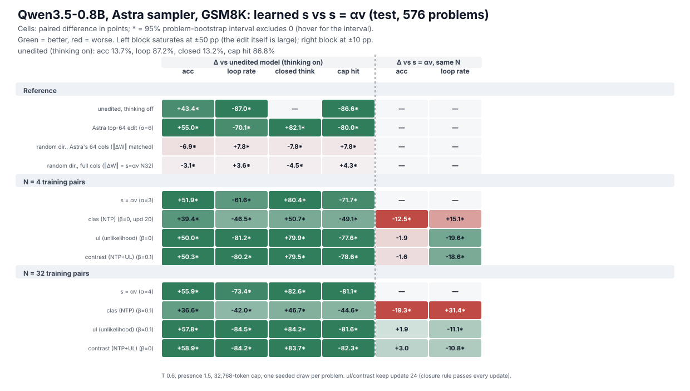
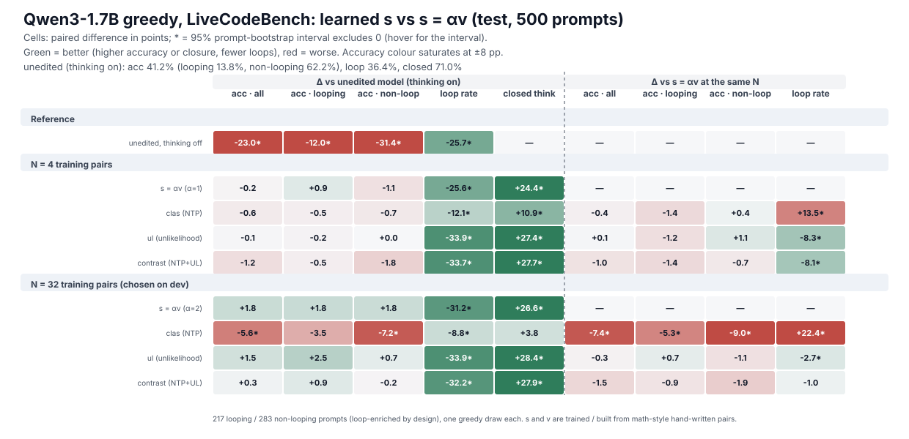

# Astra’s weight-space edit of Qwen is a special case of sensed steering

*…and what we learned from searching the design space.*

In [*Sparks of Weight-Space Programming*](https://rikiyat.github.io/blog/weight-space-programming/), GPT-6 Astra edits Qwen3.5-0.8B without any training: it writes a short program that changes parts of MLP output matrices, and the edited model’s MATH-500 accuracy rises from 7.9% to 48.1%. The authors interpret this as Weight-Space Programming: Astra “uses its reasoning to figure out what each part of a neural network computes, or should compute, and changes the weights accordingly.” The [tweet](https://x.com/rikiyatakehi/status/2117313742891327994) has been viewed nearly 10 million times. We provide an alternative interpretation: the edit is equivalent to an activation steering method already known in the literature. Viewed this way, the edit can also be improved, and in some settings we do better than Astra’s edit.

## TL;DR

- **[Astra’s Qwen edit](https://rikiyat.github.io/blog/weight-space-programming/) is equivalent to activation steering:** push along a fixed direction, with a strength read from the current activations. We call this sensed steering in this post.
- **Learning the sensing vector can further reduce looping in some settings.** In the Astra setup, our learned sensors suppress exact repetition much more than sensing along the steering direction, without a resolved accuracy difference. On a second model, Qwen3-1.7B, they do not improve on it and are less accurate.
- **Design choices matter.** What data builds the steering direction (short synthetic pairs worked best), where the sensor reads (the same sensor behaves differently on the MLP write and on the residual stream), and which loss and early-stopping rule train the sensing vector.

This is a post about that design space of sensed steering, building on [Contextual Linear Activation Steering (CLAS)](https://arxiv.org/html/2604.24693v2) and using loop reduction as an example.

## 1. From a weight edit to sensed steering

In the authors’ words:

>All of this is possible without allowing Astra to write training loops. It uses its reasoning to figure out what each part of a neural network computes, or should compute, and changes the weights accordingly. We call this Weight-Space Programming. Throughout the history of deep learning, we encoded our simplistic inductive biases into tiny symbolic optimizers like Adam or Muon. This is changing: our neural network weights will soon be natively optimized by LLMs that deliberately reason about their weights.

For the Qwen3.5-0.8B edit, we show below that it is equivalent to a known form of activation steering, and that in some settings this view lets us improve on it.

There is already a discussion of how to describe this work, including [Matthew Honnibal’s account of the tools and feedback](https://honnibal.dev/blog/astra-read-write-misleading), [Sean Goedecke’s commentary](https://seangoedecke.com/llms-are-not-superhuman-at-reading-and-writing-neural-network-weights/), and [crabbix’s LessWrong post](https://www.lesswrong.com/posts/uvKSq6eWkud997ie7/). We provide a formulation of this class of algorithms and some experiments decoupling sensing from steering.

### Formulation: sensed steering

Let an MLP’s hidden activations be \(h\), its down-projection matrix be \(W\), and its contribution to the residual stream be \(x=Wh\). Consider

$$
x' = x-v(s^\top x).
$$

There are two vectors here:

- \(v\), the **steering direction**, says where to push;
- \(s\), the **sensing vector**, determines the strength of the push at each token.

Here the strength depends on what the MLP is writing. Because the sensor is linear, this intervention can be folded into the weights:

$$
W'=W-vs^\top W,
\qquad W'h=Wh-v(s^\top Wh).
$$

It is both an activation intervention and a weight edit. Picking $s = \alpha v$ reproduces one of Astra's weight edits on Qwen. In general, one is free to design both $s$ and $v$; in this post we focus on learning $s$, which further reduces looping.

We use **sensed steering** as an umbrella label for this separation of direction and input-dependent strength. The terminology is indebted to **Contextual Linear Activation Steering (CLAS)**, which explicitly learns a sensing vector. CLAS’s usual formulation reads the residual stream and includes a bias; ours reads the MLP write and uses no bias so it folds directly into the output projection ([Hsu et al., 2026](https://arxiv.org/html/2604.24693v2)).

**Literature Attribution**: The connection to weight edits is not new. **Arditi et al.** derive weight orthogonalization and prove its equivalence to directional ablation; **LoReFT** provides a broader family of learned low-rank representation interventions. These are foundations for our formulation ([Arditi et al., 2024](https://arxiv.org/html/2406.11717v3); [Wu et al., 2024](https://arxiv.org/html/2404.03592v3)). Other nearby precedents include **CAST**, which conditions whether steering is applied on the input context, and **ROME**, which makes rank-one edits to feed-forward weights for factual associations ([Lee et al., 2025](https://arxiv.org/abs/2409.05907); [Meng et al., 2022](https://arxiv.org/abs/2202.05262)).

Astra’s submitted edit is a masked variant of \(s=\alpha v\): it senses only 64 selected MLP neurons per layer, with \(\alpha=6\). The [endnote](#note-neuron-selection-in-astras-final-edit) gives the exact update.

## 2. First, baselines

We reproduce the experiment in Qwen3.5-0.8B’s thinking mode under Astra’s sampler: temperature 0.6, top-p 0.95, top-k 20, presence penalty 1.5, and a 32,768-new-token cap.

Our evaluation uses 1,152 of the authors’ confirmation problems: 576 GSM8K training problems and 576 MATH training problems.

| Reference | Accuracy | Loop | Cap hit |
|---|---:|---:|---:|
| Unedited, thinking on | 12.1% | 87.2% | 88.6% |
| Unedited, thinking off | 53.0% | 4.5% | 5.5% |
| Astra’s submitted top-64 edit | 59.3% | 29.9% | 19.2% |

With thinking turned off, the unedited model already scores 53.0%, against 59.3% with Astra’s edit. With thinking on, it scores 12.1%: it loops on 87.2% of problems and hits the token cap on 88.6%, so most answers never finish. Of the edit’s 47-point gain over thinking-on, turning thinking off recovers 41 points; the edit adds about 6 points beyond that. We therefore read the edit as mainly fixing a pathological generation behavior, not installing new mathematical capability. Our reproduced 59.3% is close to the authors’ 60.4% on their confirmation table.

Throughout this post, a **loop** means a 30-token sequence appearing at least 20 times in a completion. We also track hitting the cap and emitting `</think>`. Those measure different failures: a model can keep paraphrasing without crossing the repetition threshold, or close thinking and still produce a problematic final answer.

## 3. Learn what to sense: can we beat Astra's edit

The simplest full-column baseline sets \(s=\alpha v\). It uses the same direction to recognize the relevant activity and to change it. Why should those be the same job? 

We keep \(v\) fixed and learn \(s\), initialized at zeros, on a dataset that can consist of positive and/or negative traces. Here a negative trace is simply one that loops. We compare three objectives:

Let \(p_s\) be the model with learned sensing vectors and \(p_0\) the unedited model. With teacher-forced prefixes, define

$$
\begin{aligned}
L_{\mathrm{NTP}}(s)&=-\mathbb{E}_{+}\log p_s(y_t\mid y_{<t}),\\
L_{\mathrm{UL}}(s)&=-\mathbb{E}_{-}\log\bigl(1-p_s(y_t\mid y_{<t})\bigr),\\
K(s)&=\mathbb{E}_{+}D_{\mathrm{KL}}\!\left(p_0(\cdot\mid y_{<t})\,\|\,p_s(\cdot\mid y_{<t})\right).
\end{aligned}
$$

Here \(\mathbb{E}_{+}\) averages over productive assistant tokens; \(\mathbb{E}_{-}\) averages over repetitive-text tokens from the second copy of the repeated sentence onward. We average tokens within each trace, then average across pairs. Only \(s\) is optimized.

| Label we use | Training signal | Objective to minimize |
|---|---|---|
| **clas / NTP** | Increase next-token likelihood on positive/productive traces | $L_{\mathrm{NTP}}+\beta K$ |
| **ul / unlikelihood** | Decrease the probability of repeated tokens in repetitive/negative text | $L_{\mathrm{UL}}+\beta K$ |
| **contrast / NTP+UL** | Combine productive next-token likelihood with repetitive-token unlikelihood | $L_{\mathrm{NTP}}+L_{\mathrm{UL}}+\beta K$ |

The retention weight is \(\beta\in\{0,0.1\}\). The label “clas” denotes our productive-text-only, no-bias, write-sensing adaptation of the original CLAS paper.

We use either the four original pairs (copied from the weight edit work) or those four plus 28 additional hand-written pairs. The same pairs construct \(v\) and train \(s\). At each edited layer, \(v\) is the difference between the mean residual stream (the block output) over the last 36 tokens of the repetitive text and that of the productive text, averaged over pairs and normalized to unit length. Comparisons between sensing methods are within the same pair count. For scaled-direction sensing (Astra's method) we test \(\alpha\in\{1,2,3,4\}\). Sensing vector training uses Adam, learning rate 0.003, and at most 24 full-batch updates. Development data select the settings; evaluation compares the selected member of each family. We discuss the stopping rule below.

**The goal is to reduce looping without harming accuracy.** 

### Much less exact repetition; similar measured accuracy

*Figure 1a. GSM8K, 576 problems. Left: differences from unedited thinking-on. Right: differences from scaled-direction sensing at the same pair count. Stars mark 95% paired bootstrap intervals excluding zero; they are not corrected for multiple comparisons.*

*Figure 1b. MATH, 576 problems, with the same comparisons. The completion tradeoff differs substantially from GSM8K.*

At 32 pairs, scaled-direction sensing reaches **61.5% accuracy**. Unlikelihood-trained sensing reaches **62.3%** and contrast-trained **61.9%**. 

The repetition difference is much larger. The loop flag falls from **26.4%** with scaled-direction sensing to **6.8%** with unlikelihood and **7.1%** with contrast. Training $s$ can do the job better.

At four pairs, the same pattern appears: accuracy differences are small and unresolved, while the loop flag falls from **38.8%** to roughly **11%**. Moving from four to 32 pairs adds about 6.5–7.7 accuracy points in these three families.

Productive-text-only training (clas arm) is markedly worse in this regime: 42.5% accuracy at four pairs and 42.9% at 32. It does reduce repetition relative to the unedited model, but how we train $s$ matters a lot.

### Learning the sensing vector has dataset-specific side effects

Pooled across datasets, the N=32 learned arms hit the cap more often than scaled-direction sensing: **22.0–22.7% versus 17.9%**. They also close thinking less often. But the pooled average hides where this happens:

| N=32 change versus scaled-direction sensing | GSM8K: UL / contrast | MATH: UL / contrast |
|---|---:|---:|
| Accuracy | +1.9 / +3.0 pp | −0.3 / −2.3 pp |
| Exact-loop flag | −11.1 / −10.8 pp | −28.1 / −27.8 pp |
| Cap hits | −0.5 / −1.2 pp | +8.7 / +10.9 pp |
| Thinking closure | +1.6 / +1.0 pp | −16.5 / −16.7 pp |

On GSM8K, the completion metrics move in the favorable direction numerically. On MATH, exact repetition falls dramatically, but more answers exhaust the budget and fewer close thinking. 

Of 253 capped unlikelihood responses, **191 do not trigger our loop flag**. Suppressing exact repetition has not ensured that the model finishes. Can we steer and learn sensing to achieve multiple behaviors: less loop, more accurate, less cap hit all together? This is one future direction:)

## 4. The design space of sensed steering: what we learned

### Where the sensor reads matters

There are three sites worth distinguishing: hidden neurons \(h\), the MLP write \(x=Wh\), and the accumulated residual stream \(r\).

Even when two interventions use the same \(v\) and \(s\),

$$
x'=x-v(s^\top x)
\qquad\text{and}\qquad
r'=r-v(s^\top r)
$$

sense different quantities. The second sensor sees the accumulated stream: the embedding, every earlier attention and MLP write, and the corrections made by earlier edits.

This changes what the same \(s\) does. Let \(\gamma=s^\top v\) with unit \(v\); for \(s=\alpha v\), \(\gamma=\alpha\). At the write, each edit multiplies the sensed coordinate of its own MLP's write by \(1-\gamma\), once, and leaves the rest of the stream alone. On the residual stream, each edited layer acts on everything already in the stream, so content from before the first edited layer is multiplied by \(1-\gamma\) at every edited layer: by \((1-\gamma)^2\) over two layers. At \(\gamma=1\) this is directional ablation of \(v\) ([Arditi et al., 2024](https://arxiv.org/html/2406.11717v3)). For \(1<\gamma<2\) the coordinate flips sign and shrinks, and for \(\gamma>2\) it flips sign and grows. The derivation is in [write_vs_residual_math.html](write_vs_residual_math.html).

A scaled direction tuned at the write, \(s=4v\), has \(\gamma=4\): on the residual stream, older content along \(v\) is flipped twice and multiplied by \((1-4)^2=9\) if both layers share one \(v\); with the two layers' actual directions its norm grows 7.8 times. The learned N=32 unlikelihood sensor is mostly not along \(v\) (cosine 0.15): \(\gamma\) is 0.34 at layer 15 and 0.29 at layer 19, so on the residual stream older content along \(v\) is scaled to 0.57 of its size, with no sign flip.

We moved these two N=32 edits from the MLP write to the residual stream in the Astra setup, keeping \(v\) and \(s\) unchanged (1,152 problems):

| Edit | Site | Accuracy | Loop | Cap hit |
|---|---|---:|---:|---:|
| \(s=4v\) | MLP write | 61.5% | 26.4% | 17.9% |
| \(s=4v\) | Residual stream | 3.0% | 95.9% | 77.3% |
| Learned unlikelihood \(s\) | MLP write | 62.3% | 6.8% | 22.0% |
| Learned unlikelihood \(s\) | Residual stream | 61.5% | 4.1% | 22.5% |

The learned sensor, trained at the write, transfers to the residual stream: accuracy changes by −0.8 points [−3.1, +1.6] and the loop rate by −2.7 points. The scaled direction at its write-tuned strength collapses.

In earlier Qwen3-1.7B experiments, using the same short-pair steering direction at blocks 15–18, the two sites also differed. The following are changes from an unedited control:

| Intervention | MATH loop / accuracy | LiveCodeBench loop / accuracy |
|---|---:|---:|
| Write sensing, α=2 | −14.5 / −1.3 pp | −29.0 / −1.7 pp |
| Residual sensing, α=1 | −6.9 / −12.8 pp | +2.9 / −18.3 pp |

Residual sensing at α=1 is directional ablation of each layer's \(v\) at four layers. It suppressed less repetition than write sensing at α=2 and cost 13–18 accuracy points.

### Short synthetic pairs were especially effective
We compared two ways of constructing the steering vector from difference of mean.
Setup:**Qwen3-1.7B, greedy decoding, MLP-write edits at blocks 15–18 with \(s=\alpha v\)**. We compared directions from model-generated loop/non-loop responses against Astra’s four short synthetic pairs. Evaluation used 304 MATH level-5 and 420 LiveCodeBench prompts, distinct from the later 1,000-prompt comparison. Natural directions averaged the first or last 4,096 loop-token position residuals against productive thinking states to compute the difference vectors.

| Data to build v | MATH loop / accuracy change | LiveCodeBench loop / accuracy change |
|---|---:|---:|
| Natural, first loop positions, α=2 | −3.6 / +1.6 pp | −12.1 / +1.9 pp |
| Natural, last loop positions, α=4 | −5.9 / +0.0 pp | −5.2 / −1.2 pp |
| Short synthetic, α=2 | −14.5 / −1.3 pp | −29.0 / −1.7 pp |

Short pairs gave much stronger loop suppression at α=2. 
Our tentative explanation: long responses differ in content, position and reasoning path as well as looping, adding unrelated variation to the activation contrast. Short synthetic pairs may isolate repetition more cleanly.

### When to early stop sensing vector learning?

We freeze the base model and steering direction \(v\), and optimize only the sensing vector \(s\) at each edited layer. Training uses four or 32 short synthetic productive/repetitive pairs, with the next-token, unlikelihood or combined objective above. Adam starts from \(s=0\) and takes up to 24 updates. As in ordinary ML training, we need a development criterion to choose when to stop, but what should it measure? We can cheaply score fixed development text by **teacher forcing** (feeding the saved tokens), or generate fresh answers on development prompts and measure accuracy, repetition and completion directly. The former is a proxy; the latter tests the behavior we actually want.

We first used teacher-forced loss on six separate productive/repetitive synthetic pairs supplied by Astra as the dev set. This selected update 24. On Qwen3-1.7B, however, the learned unlikelihood and contrast edits at that update frequently stopped emitting `</think>`. This suggests the dev set was not well chosen.

We then tried teacher-forced evaluation of each arm’s training objective on the unedited model’s saved responses to development prompts. That did not solve the problem: unlikelihood and contrast still favored the last update, while productive-text next-token loss favored update zero, no edit gives lowest NTP on base-generated traces for sure.

Actual rollouts exposed the mismatch between loss and behavior. We used those diagnostics to develop a more targeted teacher-forced stopping rule:

> Choose the lowest teacher-forced loop score among updates that preserve the unedited model’s rate of ranking `</think>` first at its saved closing positions.

So this is regular validation early stop with a constraint to proxy the behavior we want sensing vector to learn. On Qwen3 it selects earlier updates: 14 for the selected unlikelihood arms and 12 for contrast. 

## 5. A second model gives a less favorable answer

We also test Qwen3-1.7B under greedy decoding, editing blocks 15–18. The test set has 500 MATH level-5 and 500 LiveCodeBench prompts. The pool is every MATH level-5 problem (train, validation and test splits) and every LiveCodeBench problem (releases v1–v6), each labelled by four earlier greedy Qwen3-1.7B draws, minus the 256 development prompts. Per dataset, the test set takes every prompt that looped in at least one of the four draws (174 MATH, 217 LiveCodeBench), then a seeded uniform sample of the other prompts up to 500. Pooled numbers are plain means over these 1,000 prompts, so looping prompts carry more weight than in the full benchmarks.

The learned sensors do not improve on $s = \alpha v$. At N=32, unlikelihood is **3.4 points less accurate** [−5.9, −0.9], and contrast **2.4 points less accurate** [−4.8, −0.1]. The loss is concentrated in MATH.

*Figure 2a. Qwen3-1.7B, MATH level 5. “Looping” and “non-loop” accuracy columns refer to selection labels from earlier runs, not to the edited response’s outcome.*

Unlike the Astra setting, thinking here is worth a great deal: turning it off costs 26.4 accuracy points.

*Figure 2b. Qwen3-1.7B, LiveCodeBench. Four-pair UL/contrast suppress more repetition than scaled-v without a resolved accuracy difference on this dataset; the pooled accuracy result is less favorable.*

The pairs for learning $s$ and building $v$ are math-style text, yet the edit also helps suppress loops on code, loop suppression seems to transfer with these directions.

Our development-selected settings have not found a learned-sensing accuracy advantage here. 

## 6. The useful lesson from Astra’s edit

Editing MLP output weights or hidden layer weights can be equivalent to sensed steering at hidden activations or output writes. Astra’s short contrast pairs, sparse neuron selection and simple sensor are productive choices. Our experiments make that clearer: richer training objectives do not automatically produce better accuracy, only by getting the design choices right can we do better steering. **Which dataset to construct v and s, where to sense, and what behavior the training objective preserves.**

That also suggests a constructive role for agents. An agent can search this design space, such as trying out different sensing vector training loss, test where to sense, inspect failures, and pick different train/dev sets. The next step is to extend the CLAS/sensed steering formulation so we have more principles in choosing designs.

## 7. Limits and notes

### Decoding settings matter

On 128 development problems, switching to greedy decoding without retuning sharply reduced accuracy: Astra’s edit fell from 60.9% to 17.2%, and learned edits also lost most of their gains. Removing only the presence penalty had a smaller effect, except for productive NTP. $s$ and $v$ that work under one sampler may need retuning under another.

### Another axis: how to construct the direction

We have focused on $s$, but $v$ is another choice. A natural next comparison is between residual and MLP-output mean differences, logistic regression, recursive feature machines and a principal-component construction, keeping scaled-direction sensing.

## Reproduction details

| Item | Astra-regime comparison | Qwen3 comparison |
|---|---|---|
| Model | Qwen3.5-0.8B, revision `2fc06364715b967f1860aea9cf38778875588b17` | Qwen3-1.7B, revision `70d244cc86ccca08cf5af4e1e306ecf908b1ad5e` |
| Edited layers, zero-based | 15, 19 | 15–18 |
| Development prompts | 128, `validation_1` | 256, balanced by dataset and saved loop label |
| Evaluation prompts | 1,152: `validation_3/4`, `final_1–3` | 1,000: 500 per dataset, 391 previously looping |
| Decoding | T=0.6, top-p=0.95, top-k=20, presence=1.5 | Greedy |
| Limit | 32,768 new tokens | 40,960-token total context |
| Runtime | vLLM 0.22.1; transformers 5.22.1; H100 | Same stack; one test condition evaluated on a second H100 machine |
| Grading | Boxed-answer extraction and math-verify 0.9.0 | MATH answer verification; LiveCodeBench native tests |
| Uncertainty | Paired problem bootstrap | Paired prompt bootstrap, stratified by source, dataset and saved loop label |

Note: the two Qwen3-1.7B tables in §4 come from an earlier round on a different prompt set (304 MATH level-5 and 420 LiveCodeBench prompts), run with vLLM 0.15.0 and transformers 4.57.3. Its natural-response directions were built from earlier saved rollouts. The accompanying code reproduces everything else in this post, but not that round.

## Note: neuron selection in Astra’s final edit

The submitted edit is not the full-column map above. At each edited layer, it selects 64 MLP neurons. Let \(M\) be their diagonal selection mask and \(u\) the unit steering direction. The idealized update is

$$
W'=W-6uu^\top WM.
$$

Writing \(x_S=WMh\) for those neurons’ contribution gives

$$
x'=x-6u(u^\top x_S).
$$

**The sensor asks how much the selected neurons are writing along \(u\), and pushes back along \(u\) with six times that strength.** At this strength it is not simply an orthogonal projection.

Equivalently, it senses the hidden neurons directly:

$$
x'=x-u(q^\top h),\qquad q=6MW^\top u.
$$

This makes the distinction concrete. Neuron-space sensing selects and weights neurons. Write-space sensing weights directions in their combined output. Both are linear sensors, but selecting neurons is not generally the same as masking coordinates of the total write.

The direction comes from four short productive/repetitive text pairs: a mean residual-state difference, normalized per layer. The edit is applied at layers 15 and 19. Our independently constructed four-pair direction agrees with theirs at absolute cosine above 0.9999; for the reference runs we reconstruct their actual submitted tensors rather than substitute our reconstruction of the formula. The equations describe exact real-arithmetic identities, not promises of bitwise identity after bf16 rounding.
