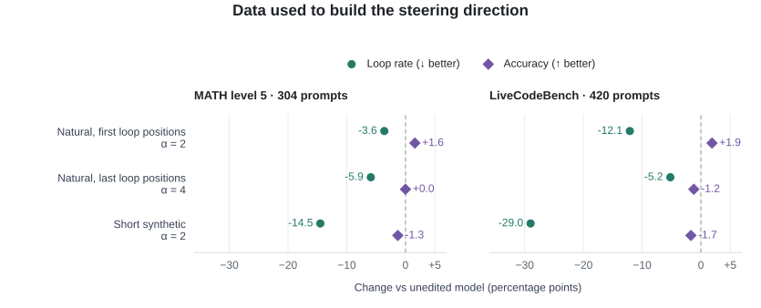

# Astra’s improvement of Qwen’s math is not “native weight editing” but context-dependent activation steering with clever use of synthetic data

*…and what we learned from searching the design space.*

In a recently widely circulated blog post [*Sparks of Weight-Space Programming*](https://rikiyat.github.io/blog/weight-space-programming/), the authors highlight how GPT-6 Astra “natively” edits another small language model without any training: it writes a short program that changes parts of MLP matrices to significantly improve the math performance of the model. The authors interpret this as Weight-Space Programming: "our neural network weights will soon be natively optimized by LLMs that deliberately reason about their weights.” The work has received much attention. For example, one of the author’s [tweet](https://x.com/rikiyatakehi/status/2117313742891327994) has been viewed nearly 10 million times. This is indeed a remarkable algorithmic performance by Astra, however we provide an alternative interpretation on how it is achieved. While the authors and many commentators interpret this as an "native" weight edit, we show that Astra implemented an algorithm similar to activation steering methods already commonly known in the literature, using, furthermore, cleverly generated synthetic data. Viewed this way, we can also improve the method over Astra’s original edit.

## TL;DR

- **[Astra’s Qwen edit](https://rikiyat.github.io/blog/weight-space-programming/) is equivalent to activation steering:** push the activation along a fixed direction learned from data, with a strength linearly dependent on the current activations.
- **Learning the "sensing vector", which adaptively changes steering strength depending on the context, can further reduce looping.** In the same setup as the original blog, our learned sensing vectors suppress exact repetition much more than Astra’s edit, which fixes the sensing direction to be the same as the steering direction.
- **Astra generated short synthetic trace pairs to build steering direction**, we find this to steer better than directions built from actual traces generated by Qwen.
  

## 1. From a “native weight edit" to activation steering

In the authors’ words:

>All of this is possible without allowing Astra to write training loops. It uses its reasoning to figure out what each part of a neural network computes, or should compute, and changes the weights accordingly. We call this Weight-Space Programming. Throughout the history of deep learning, we encoded our simplistic inductive biases into tiny symbolic optimizers like Adam or Muon. This is changing: our neural network weights will soon be natively optimized by LLMs that deliberately reason about their weights.

For the Qwen3.5-0.8B edit, we show below that it is a special case of a known form of context-dependent activation steering, and that in some settings this view lets us improve on it.

There is already a discussion of how to describe this work, including critical takes [Matthew Honnibal’s account of the tools and feedback](https://honnibal.dev/blog/astra-read-write-misleading), [Sean Goedecke’s commentary](https://seangoedecke.com/llms-are-not-superhuman-at-reading-and-writing-neural-network-weights/), and [crabbix’s LessWrong post](https://www.lesswrong.com/posts/uvKSq6eWkud997ie7/). We provide a formulation of this algorithm, some experiments decoupling sensing from steering, and highlighting Astra’s clever use of synthetic data.

### Formulation: activation steering

Let an MLP’s hidden activations be \(h\), its output weight matrix be \(W\), and its contribution to the residual stream be \(x=Wh\). Consider the steered activation vector

$$
x' = x-v(s^\top x).
$$

There are two vectors here:

- \(v\), the **steering direction**, says where to push;
- \(s\), the **sensing vector**, \(s^Tx\) determines the strength of the push given an input/context.

Here the strength depends on the output of the MLP. Because the strength is linear, this intervention is the same as a weight edit to the MLP output weight matrix:

$$
W'=W-vs^\top W,
\qquad W'h=Wh-v(s^\top Wh) = x'.
$$

In this framing, **Astra's weight edits on Qwen are simply picking $s = \alpha v$**. In general, one is free to design both $s$ and $v$; in this post we focus on learning $s$, which further reduces looping.

We use **activation steering** as an umbrella label for this separation of direction and input-dependent strength. The terminology is based on **Contextual Linear Activation Steering (CLAS), [Hsu et al., 2026](https://arxiv.org/html/2604.24693v2)**, which explicitly learns a sensing vector. 

**Literature Attribution**: The connection to weight edits was established in **[Arditi et al., 2024](https://arxiv.org/html/2406.11717v3)** derive weight orthogonalization and prove its equivalence to directional ablation; Other relevant work include **[Lee et al., 2025](https://arxiv.org/abs/2409.05907)**, **[Wu et al., 2024](https://arxiv.org/html/2404.03592v3)**, and **[Meng et al., 2022](https://arxiv.org/abs/2202.05262)**.

## 2. First, baselines

We reproduce the experiment in Qwen3.5-0.8B’s thinking mode under the blog setting, see [reproduction details](#reproduction-details) and [code](https://github.com/Zhi0467/qwen-loop-steering-experiments). Our reproduction matches the blog’s numbers up to noise.

Throughout this post, a **loop** means a 30-token sequence appearing at least 20 times, a trace is said to loop if it contains at least one loop, **cap hit** means generation reaching the token cap.

Our evaluation uses 1,152 of the authors’ confirmation problems: 576 GSM8K training problems and 576 MATH training problems.

| Reference                     | Accuracy | Loop  | Cap hit |
| ----------------------------- | -------: | ----: | ------: |
| Unedited, thinking on         | 12.3%    | 87.0% | 88.5%   |
| Unedited, thinking off        | 53.3%    | 4.5%  | 5.3%    |
| Astra’s submitted top-64 edit | 60.2%    | 29.6% | 18.2%   |

 We note the edit as mainly fixing a pathological generation behavior, rather than installing new mathematical capability. 

## 3. Learn the sensing vector can improve on Astra’s edit

The canonical edit from the original blog sets \(s=\alpha v\). It uses the same direction to recognize the sense the context and to push/steer it. We keep \(v\) fixed and learn \(s\), initialized at zeros rather than \(v\), on a dataset that can consist of non-loop and/or loop traces. To clarify terminology, non-loop = productive (as in their blog) = positive, and conversely, loop = negative. We compare three loss functions for learning \(s\):

Let \(p_s\) be the steered model and \(p_0\) the unedited model. With teacher-forced prefixes, define

$$
\begin{aligned}
L_{\mathrm{NTP}}(s)&=-\mathbb{E}_{+}\log p_s(y_t\mid y_{<t}),\\
L_{\mathrm{UL}}(s)&=-\mathbb{E}_{-}\log\bigl(1-p_s(y_t\mid y_{<t})\bigr),\\
K(s)&=\mathbb{E}_{+}D_{\mathrm{KL}}\!\left(p_0(\cdot\mid y_{<t})\,\|\,p_s(\cdot\mid y_{<t})\right).
\end{aligned}
$$

Here \(\mathbb{E}_{+}\) averages over productive assistant tokens; \(\mathbb{E}_{-}\) averages over repetitive-text tokens from the second copy of the repeated sentence onward. We average tokens within each trace, then average across pairs. Only \(s\) is optimized, model weights are frozen. The KL regularization coefficient is \(\beta\in\{0,0.1\}\). 

| Label we use         | Training signal on s                                                      | Objective to minimize                      |
| -------------------- | ------------------------------------------------------------------------- | ------------------------------------------ |
| **clas**             | Increase next-token likelihood on positive traces                         | $L_{\mathrm{NTP}}+\beta K$                 |
| **ul**               | Decrease the probability of repeated tokens in negative traces            | $L_{\mathrm{UL}}+\beta K$                  |
| **contrast**         | Combine positive next-token likelihood with repetitive-token unlikelihood | $L_{\mathrm{NTP}}+L_{\mathrm{UL}}+\beta K$ |
| **\(s = \alpha v\)** | \(\alpha\) is sweeped                                                     | -                                          |

We use either the four original pairs (copied from the original blog’s repo) or those four plus 28 additional hand-written pairs. The same dataset is used to construct \(v\) and train \(s\). At each edited layer, \(v\) is the difference between the mean residual stream over the last 36 tokens of the repetitive text and that of the productive text, averaged over pairs and normalized to unit length. For \(s = \alpha v\) (Astra's method) we sweep \(\alpha\). Sensing vector training uses Adam with early stopping. Development data select hyper-parameters and early stop step.

**The goal is to reduce the fraction of traces that loop, while accuracy, thinking closure, and cap hits are tracked as side effects.** 

### Much less looping; learning s with negative examples matters

  

*Figure 1a. GSM8K, 576 problems. Left: differences from unedited thinking-on. Right: differences from scaled-direction sensing at the same pair count. Stars mark 95% paired bootstrap intervals excluding zero.*

  

*Figure 1b. MATH, 576 problems, with the same comparisons.*

The looping difference is quite large. The loop flag falls from **27.2%** with \(s = \alpha v\) to **6.5%** with unlikelihood and **6.8%** with contrast, using 32 pairs. Training $s$ can do the intended job of fixing this pathological behavior better. At 4 pairs, the loop flag again falls, from **29.5%** to roughly **11%**.

At 32 pairs, \(s = \alpha v\) reaches **60.7% accuracy**. Unlikelihood-trained sensing reaches **61.6%** and contrast-trained **61.5%**; both differences have 95% intervals that contain zero, meaning accuracies from these steering methods cannot be statistically separated.Positive-trace-only sensing vector training (clas arm) is markedly worse in this setting. It does reduce repetition relative to the unedited model, but this shows how we train $s$ matters a lot.

## 4. The design space of activation steering: what we learned

### Short synthetic pairs are especially effective
We compare two ways of constructing the steering vector from difference of mean. Setup: **Qwen3-1.7B, greedy decoding, MLP-output edits at blocks 15–18 with \(s=\alpha v\)**. We compare directions from model-generated loop/non-loop responses against Astra’s four short synthetic pairs. Evaluation used 304 MATH level-5 and 420 LiveCodeBench prompts, distinct from the test set in next section. Natural directions averaged the first or last 4,096 loop-token position residuals against non-loop thinking token residuals to compute the mean-of-difference vectors.

Short pairs gave much stronger loop suppression at α=2. Our tentative explanation: long responses differ in content, position and reasoning path as well as looping, adding unrelated variation to the activation contrast. Short synthetic pairs may isolate repetition more cleanly.

### Where to sense matters

There are three sites worth distinguishing: hidden neurons \(h\), the MLP output \(x=Wh\), and the accumulated residual stream \(r\).Even when two interventions use the same \(v\) and \(s\),

$$
x'=x-v(s^\top x)
\qquad\text{and}\qquad
r'=r-v(s^\top r)
$$

sense different quantities. The second sensing sees the accumulated stream: the embedding, every earlier attention and MLP output, and the corrections made by earlier edits.

This changes what the same \(s\) does. Take \(s=\alpha v\) with unit \(v\). At the output, each edit multiplies the sensed coordinate of its own MLP's output by \(1-\alpha\), once, and leaves the rest of the stream alone. On the residual stream, each edited layer acts on everything already in the stream, so content from before the first edited layer is multiplied by \(1-\alpha\) at every edited layer: by \((1-\alpha)^2\) over two layers. At \(\alpha=1\) this is directional ablation of \(v\) ([Arditi et al., 2024](https://arxiv.org/html/2406.11717v3)). For \(1<\alpha<2\) the coordinate flips sign and shrinks, and for \(\alpha>2\) it flips sign and grows. 

We moved these two N=32 edits from the MLP output to the residual stream in the Astra setup, keeping \(v\) and \(s\) unchanged. We also recalibrated $\alpha$ for the residual stream with \(\alpha\in\{0.2,0.5,1,1.5\}\), chosen on the development problems like every other setting. Development accuracy was 39.8%, 66.0%, 66.0% and 63.7%; of the two tied settings, \(\alpha=1\) loops less (3.5% against 12.5%) and was chosen. On the 1,152 test problems:

| Edit                       | Where to sense  | Accuracy | Loop  | Cap hit |
| -------------------------- | --------------- | -------: | ----: | ------: |
| \(s=4v\)                   | MLP output      | 60.7%    | 27.2% | 18.3%   |
| \(s=4v\)                   | Residual stream | 2.9%     | 96.4% | 77.6%   |
| \(s=v\) (recalibrated)     | Residual stream | 62.7%    | 3.9%  | 19.9%   |
| Learned unlikelihood \(s\) | MLP output      | 61.6%    | 6.5%  | 22.3%   |
| Learned unlikelihood \(s\) | Residual stream | 61.6%    | 4.6%  | 22.5%   |

The learned sensing vector, trained to sense the MLP output, transfers to the residual stream with a similar benefit. The scaled direction cannot transfer its learned $\alpha$. Recalibrated to \(\alpha=1\), it gives a similar benefit to the output sensing edits: about the same accuracy, with loop rates as low as the learned sensing vector's.

### When to early stop sensing vector learning?

Training uses four or 32 short synthetic productive/repetitive pairs, with the next-token, unlikelihood or combined objective above. Adam starts from \(s=0\) and takes up to 24 updates. As in ordinary ML training, we need a development criterion to choose when to stop, but what should it measure? We can cheaply score fixed development traces by **teacher forcing** (feeding the saved tokens), or generate fresh rollouts on development prompts and measure accuracy, repetition and completion directly at each optimization step. The former is a proxy; the latter tests the behavior we actually want despite a much more expensive validation.

We first used teacher-forced loss on six separate synthetic pairs supplied by Astra as the dev set. This selected update 24. On Qwen3-1.7B, however, the learned unlikelihood and contrast edits at that update frequently stopped emitting `</think>`. This suggests the dev set was not well chosen. We then picked the development set to be the unedited model’s saved traces. That did not solve the problem: unlikelihood and contrast still favored the last update, while productive-text next-token loss favored update zero, since no edit gives lowest NTP on base-model-generated traces.

Actual rollouts exposed the mismatch between proxy loss and behavior. We then used a stopping rule requiring preservation of thinking closure:

> Choose the update with the lowest unlikelihood loss on repeated tokens in the saved development traces. Require that `</think>` remains the most likely next token at least as often as the unedited model, at the positions where the unedited model originally ended its thinking.

On Qwen3 it selects earlier updates: 12–14 for the selected unlikelihood arms and 10–12 for contrast. They are what we used for the results in the next section. 

## 5. A non-pathological setting shows loop reduction with similar accuracy

We also test Qwen3-1.7B under greedy decoding, editing blocks 15–18, on 500 MATH level-5 and 500 LiveCodeBench prompts ([reproduction details](#reproduction-details)). Unlike the Astra setting, thinking here is worth a great deal: turning it off costs 26.4 accuracy points. Here are some observations:
- either \(s = \alpha v\) or learned sensing vector can reduce loop more than thinking off (except for N = 32 clas).
- learned sensing vectors with negative examples reduce more loops than \(s = \alpha v\).
- learned sensing vectors with negative examples can minimally hurt accuracy on non-loop examples.
- overall, this modestly shows activation steering as a way to reduce loop while retaining accuracy in a **non-pathological setting.**

The pairs for learning $s$ and building $v$ are math-style text, yet the edit also helps suppress loops on code, loop suppression seems to transfer with these directions. Our development-selected settings have not found a learned sensing vector accuracy advantage here, but it still tends to reduce looping more than \(s = \alpha v\) which is the intended effect. 

## 6. Notes 

#### Using short synthetic pairs is a clever choice
 Astra’s short contrast pairs and simple \(s = \alpha v\) are productive choices. **Which dataset (synthetic versus long on-policy rollouts) to construct v and s, where to sense (output versus residual), and what behavior the training objective preserves** are all consequential design choices. This also suggests a constructive role for agents. An agent can search this design space, such as trying out different sensing vector training loss, test where to sense, inspect failures, and pick different train/dev sets. 

#### Decoding settings matter

On 128 development problems, switching to greedy decoding without retuning sharply reduced accuracy: Astra’s edit fell from 60.5% to 15.6%, and learned edits also lost most of their gains. Removing only the presence penalty had a smaller effect. $s$ and $v$ that work under one temperature may need retuning under another.

#### Another axis: how to construct the direction

We focused on $s$ in this post, but $v$ is another choice to learn from data. A natural next comparison is constructing $v$ with different algorithms: mean differences of residual, logistic regression, recursive feature machines and PCA, keeping sensing vector fixed.

#### Learning the sensing vector has dataset-specific side effects

Pooled across datasets, the N=32 learned arms hit the cap more often than scaled-direction sensing: **22.3–23.0% versus 18.3%**. They also close thinking less often. But the pooled average hides where this happens:

| N=32 change versus scaled-direction sensing | GSM8K: UL / contrast | MATH: UL / contrast |
| ------------------------------------------- | -------------------: | ------------------: |
| Accuracy                                    | +1.8 / +3.2 pp       | +0.1 / −1.6 pp      |
| Exact-loop flag                             | −11.5 / −11.3 pp     | −29.9 / −29.5 pp    |
| Cap hits                                    | −0.6 / −1.0 pp       | +8.6 / +10.4 pp     |
| Thinking closure                            | +2.1 / +1.6 pp       | −16.9 / −17.2 pp    |

On GSM8K, the completion metrics move in the favorable direction numerically. On MATH, exact repetition falls dramatically, but more answers exhaust the budget and fewer close thinking. Of the capped unlikelihood responses, 78% do not loop. Suppressing exact repetition has led to the steered model paraphrasing while hitting generation cap in some cases. Can we steer multiple behaviors at once? 

#### Reproduction details
You can find code at this [repo](https://github.com/Zhi0467/qwen-loop-steering-experiments).

| Item                      | Astra-regime comparison                                           | Qwen3 comparison                                                            |
| ------------------------- | ----------------------------------------------------------------- | --------------------------------------------------------------------------- |
| Model                     | Qwen3.5-0.8B, revision `2fc06364715b967f1860aea9cf38778875588b17` | Qwen3-1.7B, revision `70d244cc86ccca08cf5af4e1e306ecf908b1ad5e`             |
| Edited layers, zero-based | 15, 19                                                            | 15–18                                                                       |
| Development prompts       | 128, `validation_1`                                               | 256, balanced by dataset and saved loop label                               |
| Evaluation prompts        | 1,152: `validation_3/4`, `final_1–3`                              | 1,000: 500 per dataset, 391 previously looping                              |
| Decoding                  | T=0.6, top-p=0.95, top-k=20, presence=1.5                         | Greedy                                                                      |
| Limit                     | 32,768 new tokens                                                 | 40,960-token total context                                                  |
| Runtime                   | vLLM 0.22.1; transformers 5.22.1; H100                            | Same stack; H100s on two machines                                           |
| Grading                   | Boxed-answer extraction and math-verify 0.9.0                     | MATH answer verification; LiveCodeBench native tests                        |
| Uncertainty               | Paired problem bootstrap                                          | Paired prompt bootstrap, stratified by source, dataset and saved loop label |

**Qwen3 test sampling.** From all MATH level-5 splits and LiveCodeBench v1–v6, excluding 256 development prompts, we retained every prompt that looped in any of four earlier greedy Qwen3-1.7B draws (174 MATH, 217 LiveCodeBench) and filled each dataset to 500 by seeded uniform sampling of the rest. Pooled metrics are plain means over these 1,000 prompts.

Note: the two Qwen3-1.7B comparisons in §4 come from an earlier round on a different prompt set (304 MATH level-5 and 420 LiveCodeBench prompts), run with vLLM 0.15.0 and transformers 4.57.3. Its natural-response directions were built from earlier saved rollouts. The accompanying code reproduces everything else in this post, but not that specific experiment. 

#### neuron selection in Astra’s final edit

The final Astra edit is not the MLP output sensing above. At each edited layer, it selects 64 MLP neurons. Let \(M\) be their diagonal selection mask and \(u\) the unit steering direction. The idealized update is

$$
W'=W-6uu^\top WM.
$$

Writing \(x_S=WMh\) for those neurons’ contribution gives

$$
x'=x-6u(u^\top x_S).
$$

Equivalently, it senses the hidden neurons directly:

$$
x'=x-u(q^\top h),\qquad q=6MW^\top u.
$$

Neuron-space sensing selects and weights neurons. Output-space sensing weights directions in their combined output. Both are sensing vectors, but selecting neurons is not generally the same as masking coordinates of the MLP output.
