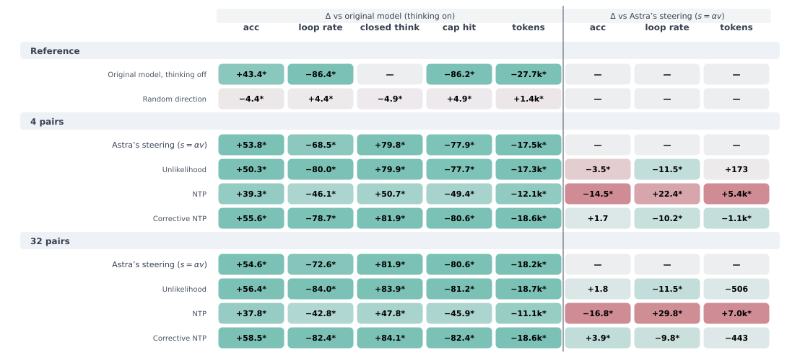
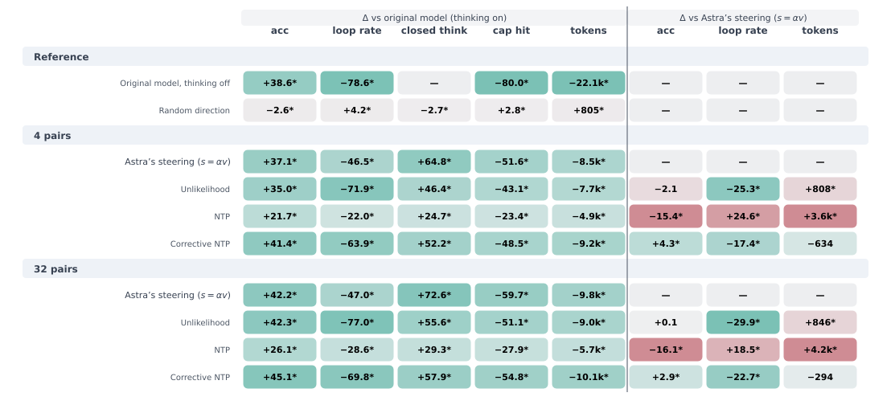
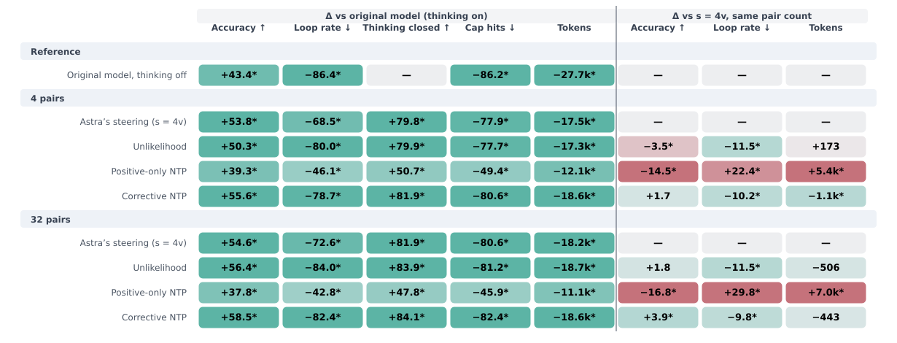
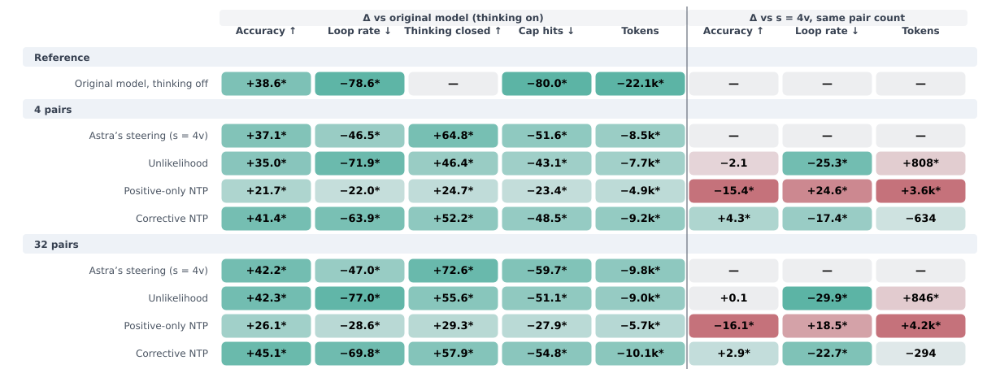
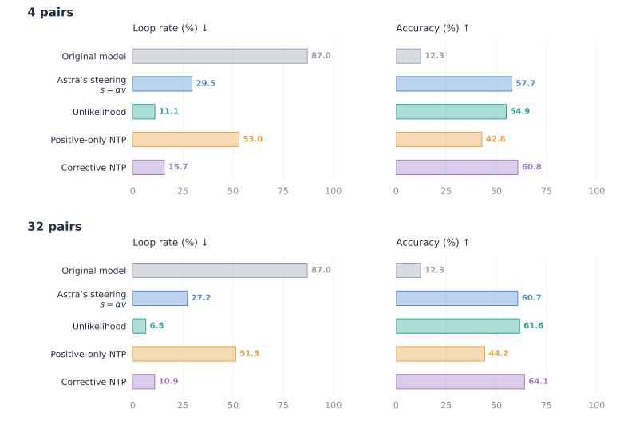
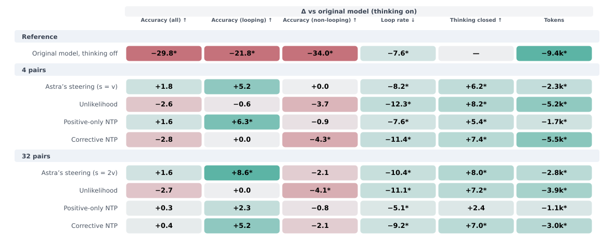
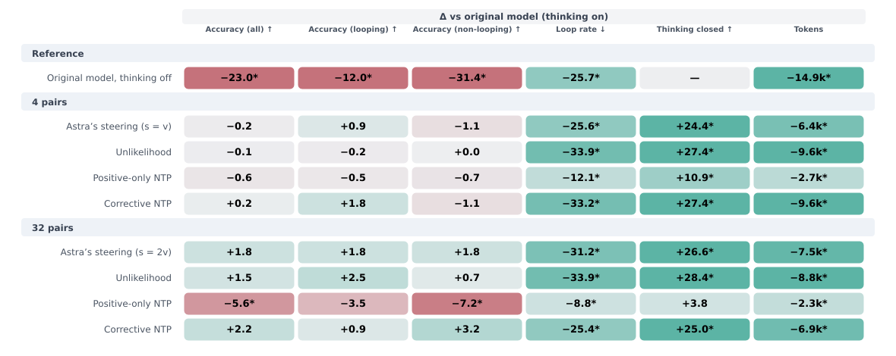

# Supplementary methods and results

[Back to the post](main.md).

## Corrective NTP

The same underlying 4 or 32 positive/negative pairs supply the data, and the steering directions are unchanged. At each pair's branch point, insert its own loop chunk before the positive continuation. For a pair containing K copies, construct every prefix length k = 2, …, K. Average target-token loss within each variant, then across variants within a pair, then across pairs. N counts underlying pairs, not expanded sequences.

Only the positive continuation is an NTP target; the inserted repetitions are context. The target mask includes the boundary-space token. KL remains on the original positive text. The steering direction is not reconstructed from augmented text.

The implementation is in [`loop_s_learn.py`](../scripts/steer/loop_s_learn.py), in `doubt_text`, `build_items` and `losses`. The run recipes are [`astra_clasd.sh`](../run/astra_clasd.sh) and [`qwen3_clasd.sh`](../run/qwen3_clasd.sh). Adam uses learning rate 0.003, up to 24 updates from s = 0, N ∈ {4, 32}, and β ∈ {0, 0.1}. All four candidates retained update 24 under the closure-constrained stopping rule. Development accuracy, with loop rate as tie-breaker, selected β = 0.1 for both N. In Qwen3-1.7B, the same training construction uses greedy decoding and blocks 15–18. The stopping rule selects update 16 for the 4-pair candidates and update 8 for the 32-pair candidates; development selection chooses β = 0.1 and β = 0, respectively.

**Aggregation and uncertainty.** Original Astra methods average each problem's outcome over two runs. Corrective NTP currently contributes one run. The combined summary compares its outcomes against those per-problem averages on the same 1,152 problems. Paired problem-bootstrap intervals describe problem-resampling uncertainty, not run-to-run variability.

**Released files.** The combined summaries are
[`results/astra_regime/test_summary_with_clasd.json`](../results/astra_regime/test_summary_with_clasd.json)
and [`results/qwen3/exp1_test_summary_with_clasd.json`](../results/qwen3/exp1_test_summary_with_clasd.json).
Development selections are bundled as
[`dev_selection_clasd.json`](../results/astra_regime/dev_selection_clasd.json)
and [`selection_clasd.json`](../results/qwen3/selection_clasd.json).
The [README](../README.md#use-released-results-no-gpu-runs) gives commands to
recompute these summaries from the bundled per-prompt scored records.

**Code labels.** NTP: clas; Corrective NTP: clasd; Unlikelihood: ul; Contrast: contrast.

## Additional objective: Contrast

Reproduce this objective with the base runs: `bash run/astra_exp1.sh` and
`STOP_TRACES=ours bash run/qwen3_exp1.sh` (after repository setup).

Contrast minimizes the unweighted sum of NTP on original positive traces, Unlikelihood on negative traces, and β times KL on positive traces. The relative weighting of NTP and Unlikelihood was not tuned. Its results are retained here as a supplementary comparison, not evidence that this weighting is optimal.

## Astra pooled results

| Method | Pairs | Accuracy | Loop | Cap hit | Mean completion tokens |
|---|---:|---:|---:|---:|---:|
| s = 4v | 4 | 57.7% | 29.5% | 23.7% | 16,507 |
| NTP | 4 | 42.8% | 53.0% | 52.1% | 21,012 |
| Corrective NTP | 4 | 60.8% | 15.7% | 23.9% | 15,633 |
| Unlikelihood | 4 | 54.9% | 11.1% | 28.0% | 16,997 |
| Contrast | 4 | 55.3% | 11.0% | 26.7% | 16,706 |
| s = 4v | 32 | 60.7% | 27.2% | 18.3% | 15,544 |
| NTP | 32 | 44.2% | 51.3% | 51.6% | 21,142 |
| Corrective NTP | 32 | 64.1% | 10.9% | 19.9% | 15,175 |
| Unlikelihood | 32 | 61.6% | 6.5% | 22.3% | 15,714 |
| Contrast | 32 | 61.5% | 6.8% | 23.0% | 15,714 |

## Detailed protocols and diagnostics
 

**Reproduction details.** Code can be found [here](https://github.com/Zhi0467/astra-weight-edit-as-steering).

| Item                       | Astra-regime comparison                                           | Qwen3 comparison                                                            |
| -------------------------- | ----------------------------------------------------------------- | --------------------------------------------------------------------------- |
| Model                      | Qwen3.5-0.8B, revision `2fc06364715b967f1860aea9cf38778875588b17` | Qwen3-1.7B, revision `70d244cc86ccca08cf5af4e1e306ecf908b1ad5e`             |
| Steered layers, zero-based | 15, 19                                                            | 15–18                                                                       |
| Development prompts        | 128, `validation_1`                                               | 256, balanced by dataset and saved loop label                               |
| Evaluation prompts         | 1,152: `validation_3/4`, `final_1–3`                              | 1,000: 500 per dataset, 391 previously looping                              |
| Decoding                   | T=0.6, top-p=0.95, top-k=20, presence=1.5                         | Greedy                                                                      |
| Limit                      | 32,768 generated tokens (excluding the prompt)                                                 | 40,960 tokens total (prompt plus completion)                                                  |
| Runtime                    | vLLM 0.22.1; transformers 5.22.1; H100                            | Same stack; H100s on two machines                                           |
| Grading                    | Boxed-answer extraction and math-verify 0.9.0                     | MATH answer verification; LiveCodeBench native tests                        |
| Uncertainty                | Paired problem bootstrap                                          | Paired prompt bootstrap, stratified by source, dataset and saved loop label |

**Qwen3 test sampling.** From all MATH level-5 splits and LiveCodeBench v1–v6, excluding 256 development prompts, we retained every prompt that looped in any of four earlier greedy Qwen3-1.7B draws (174 MATH, 217 LiveCodeBench) and filled each dataset to 500 by seeded uniform sampling of the rest. Pooled metrics are plain means over these 1,000 prompts.

**Natural traces (§5).** The looping examples are the last 36 loop tokens of 32 looping traces from the unedited model's greedy development rollouts (9 MATH, 23 LiveCodeBench; few MATH development traces loop). The non-looping examples are the last 36 thinking tokens before `</think>` of 32 traces that finish (16 per dataset). Prompts whose traces the stopping rule scores are excluded. As with the short pairs, \(v\) is the per-layer difference of mean activations, and the trained \(s\) uses unlikelihood on the loop tokens plus \(\beta\) times the KL divergence on the non-looping tokens. The 64 prompts behind these traces are removed from development, so both data sources are selected on the remaining 192 development prompts, over \(\alpha \in \{1,2,3,4\}\) and \(\beta \in \{0, 0.1\}\). Short pairs choose \(s = 2v\), natural traces \(s = v\), and both choose \(\beta = 0\). The natural \(v\) has cosine 0.54–0.59 with the short-pair \(v\). The rollouts use a 40,960-token context limit (prompt plus completion). The preceding rollout is retained as context, but sensing-vector training scores only the selected windows, not the entire rollout.

**Using short synthetic pairs is a clever choice.** Astra’s short contrast pairs and simple \(s = \alpha v\) are effective choices. **Which dataset (synthetic versus long on-policy rollouts) to construct v and s, where to sense (output versus residual), and what behavior the training objective preserves** are all consequential design choices. This also suggests a constructive role for agents. An agent can search this design space, such as trying out different sensing vector training loss, test where to sense, inspect failures, and pick different train/dev sets. 

**Steering does not transfer across temperatures.** On 128 development problems, switching to greedy decoding without retuning sharply reduced accuracy: the 32-pair $s=4v$ steering fell from 63.7% to 28.1%, and trained sensing vectors also lost most of their gains. Removing only the presence penalty had a smaller effect. $s$ and $v$ that work under one temperature may need retuning under another.

**Another axis: how to construct steering direction.** We focused on $s$ in this post, but $v$ is another vector to construct from data. A natural next comparison is constructing $v$ with different algorithms: mean differences of residual, logistic regression, recursive feature machines and PCA, keeping sensing vector fixed.

**Training the sensing vector has dataset-specific side effects.** Pooled across datasets, the N=32 Unlikelihood and Contrast methods hit the cap more often than \(s=\alpha v\): **22.3–23.0% versus 18.3%**. They also close thinking less often. But the pooled average hides where this happens:

| N=32 change versus \(s=\alpha v\) | GSM8K: UL / contrast | MATH: UL / contrast |
| --------------------------------- | -------------------: | ------------------: |
| Accuracy                          | +1.8 / +3.2 pp       | +0.1 / −1.6 pp      |
| Exact-loop flag                   | −11.5 / −11.3 pp     | −29.9 / −29.5 pp    |
| Cap hits                          | −0.6 / −1.0 pp       | +8.6 / +10.4 pp     |
| Thinking closure                  | +2.1 / +1.6 pp       | −16.9 / −17.2 pp    |

On GSM8K, the completion metrics move in the favorable direction numerically. On MATH, exact repetition falls dramatically, but more answers exhaust the budget and fewer close thinking. Of the capped unlikelihood responses, 78% do not loop. Suppressing exact repetition has led to the steered model paraphrasing while hitting generation cap in some cases. Can we steer multiple behaviors at once? 

**Neuron selection in Astra’s final steering.** Later in the same run, Astra restricted steering to 64 MLP neurons per layer. This version reaches 60.2% accuracy, 29.6% looping and 18.2% cap hits; our main baseline uses the earlier $s=4v$ steering (57.7%, 29.5% and 23.7%).

With diagonal neuron mask \(M\) and unit direction \(u\), its idealized update is

$$
W'=W-6uu^\top WM,
\qquad
x'=x-u(q^\top h),\quad q=6MW^\top u.
$$

Thus \(q\) senses selected hidden neurons, rather than their combined MLP output. Selecting neurons is not the same as masking output coordinates.

Its matched random-direction control reaches 6.8% accuracy and 93.4% looping, separate from the main figures’ $s=\alpha v$ control.

**When to early stop sensing vector training?** Training uses four or 32 short synthetic positive/negative pairs, with the next-token, unlikelihood or combined objective above. Adam starts from \(s=0\) and takes up to 24 updates. As in ordinary ML training, we need a validation criterion to choose when to stop, but what should it measure? We can cheaply score fixed traces of a selected development set by **teacher forcing** (feeding the saved tokens), or generate fresh rollouts on development prompts and measure accuracy, repetition and completion directly at each optimization step. The former is a proxy; the latter tests the behavior we actually want despite a much more expensive validation.

We first used teacher-forced loss on six separate synthetic pairs supplied by Astra as the dev set. This selected update 24. On Qwen3-1.7B, however, the unlikelihood- and contrast-trained steering at that update frequently stopped emitting `</think>`. This suggests the dev set was not well chosen. We then picked the development set to be the unedited model’s saved traces. That did not solve the problem: unlikelihood and contrast still favored the last update, while positive-text next-token loss favored update zero, since no steering gives lowest NTP on base-model-generated traces.

Actual rollouts exposed the mismatch between proxy loss and behavior. We then used a stopping rule requiring preservation of thinking closure:

> Choose the update with the lowest unlikelihood loss on repeated tokens in the saved development traces. Require that `</think>` remains the most likely next token at least as often as the unedited model, at the positions where the unedited model originally ended its thinking.

On Qwen3 it selects earlier updates: 12–14 for the selected unlikelihood methods and 10–12 for contrast. These are the updates used for the Qwen3 results in the post. 

## Random-direction controls

Run `bash run/astra_exp1.sh`, then `bash run/astra_controls.sh`.

The main figures hold the steering direction fixed when comparing sensing vector methods. The full comparisons below retain the random-direction control: a seeded random unit vector per layer, with edit strength chosen to match the per-layer weight-change norm of the development-selected 32-pair Astra method. No sensing vector is trained for this control. It tests an arbitrary edit of comparable size, not a random direction with a trained sensing vector.

## Positive-only NTP comparisons

The base runs include this objective: `bash run/astra_exp1.sh` and
`STOP_TRACES=ours bash run/qwen3_exp1.sh` (after repository setup).

Positive-only NTP trains the sensing vector on the original productive traces, without inserting loop prefixes. With the steering direction fixed, its objective is

$$
L_{\mathrm{NTP}}(s)=-\mathbb{E}_{+}\log p_s(y_t\mid y_{<t}),\qquad
L(s)=L_{\mathrm{NTP}}(s)+\beta L_{\mathrm{KL}}(s).
$$

The KL term also uses the original positive traces. Tokens are averaged within each trace, then across pairs; only the sensing vector is optimized. The code label is `clas`, distinct from Corrective NTP (`clasd`).

On the Astra setting, positive-only NTP works poorly compared with Unlikelihood and Corrective NTP. On Qwen3, its pooled loop rates are 15.2% (4 pairs) and 18.1% (32 pairs), versus 2.8% and 7.8% for Corrective NTP. Its 32-pair method also loses accuracy: 53.4%, compared with 57.4% for Corrective NTP and 57.8% for Astra’s steering. The original main-text exception for 32-pair NTP referred to this positive-only method, not Corrective NTP.

The full comparisons below retain positive-only NTP alongside Corrective NTP.

Stars mark 95% paired bootstrap intervals that exclude zero. Corrective NTP has one run.
